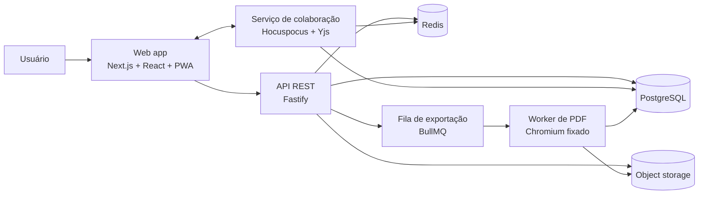

# FREEX

**Roteiros no padrão da indústria. Escrita a várias mãos. PDF impecável.**

FREEX é uma plataforma web para escrever roteiros cinematográficos e de TV com formatação automática, colaboração em tempo real e exportação para PDF com fidelidade de página. O produto é inspirado na experiência de ferramentas como Celtx, mas com uma proposta própria: o padrão de formatação é tratado como contrato técnico, não como sugestão visual.

> **Status:** fase 0, de documentação e decisões. Ainda não existe aplicação executável neste repositório. Os comandos de desenvolvimento serão definidos quando o scaffold for criado; nada aqui deve ser tratado como instalação pronta.

---

## 1. O problema

Roteiristas gastam tempo demais ajustando margens, fontes e quebras de página. Quando o formato está errado, o leitor profissional percebe antes de chegar à história: a contagem de páginas deixa de corresponder ao tempo de tela, o PDF muda de layout, e a colaboração vira troca de arquivos com versões conflitantes.

Ferramentas de texto genéricas não resolvem isso. Um roteiro não é um documento comum: é uma grade monoespaçada com seis elementos, regras de paginação e convenções que o mercado inteiro reconhece.

## 2. A proposta

FREEX reúne três garantias:

1. **Formatação travada no padrão.** O documento nasce em Courier Prime 12 pt, US Letter, com as margens e indentações da indústria. O usuário escreve; o software posiciona.
2. **Colaboração real.** Várias pessoas editam o mesmo roteiro ao mesmo tempo, com cursores, presença, permissões e histórico de versões. Sem "arquivo final v2 revisado (3).pdf".
3. **PDF fiel.** A prévia, o editor paginado e o PDF saem do mesmo motor de layout. O que está na prévia é o que o leitor recebe.

O FREEX é **gratuito**: não há plano pago, assinatura ou cobrança pelo uso.

## 3. Escopo do MVP

Incluído:

- cadastro, login e recuperação de senha;
- projetos e roteiros com controle de acesso por papel;
- editor de roteiro com os elementos do padrão (cena, ação, personagem, parêntese, diálogo, transição e variantes);
- formatação automática, paginação, numeração de páginas e quebras com `(MORE)` / `(CONT'D)`;
- colaboração em tempo real com presença e cursores;
- comentários ancorados no texto;
- histórico de versões com restauração;
- exportação para PDF com página de título, opções de publicação e validação de formato;
- edição em desktop e celular, com modo mobile de edição e prévia paginada;
- interface em português do Brasil, com o roteiro podendo usar o vocabulário de elementos em inglês ou português.

Fora do MVP:

- orçamento, cronograma, storyboard e gestão de produção;
- edição de vídeo ou integração com câmera;
- marketplace, community e cursos;
- geração de roteiro por IA;
- aplicativos nativos para celular (o MVP é web responsivo, com edição em desktop e celular);
- planos pagos, assinatura ou cobrança pelo uso.

O FREEX é gratuito por decisão de produto. Planos pagos, assinatura e cobrança não são apenas "fora do MVP"; estão fora do escopo do produto.

O escopo detalhado, com requisitos numerados e critérios de aceite, está em [`docs/01-requisitos/srs.md`](docs/01-requisitos/srs.md).

## 4. O padrão de formatação em uma tabela

Estes são os valores normativos do perfil **FREEX Standard**, baseado nas convenções usadas por Celtx, Final Draft e pela indústria de cinema dos EUA. A especificação completa, com regras de conteúdo e exceções, está em [`docs/02-roteiro/normas-de-formatacao.md`](docs/02-roteiro/normas-de-formatacao.md).

| Item | Valor |
|---|---|
| Papel | US Letter, 8,5 × 11 pol (215,9 × 279,4 mm), retrato |
| Fonte | Courier Prime 12 pt, 10 caracteres por polegada, 6 linhas por polegada |
| Margem esquerda | 1,5 pol |
| Margens direita, superior e inferior | 1,0 pol |
| Área de texto | 6,0 × 9,0 pol (60 × 54 células) |
| Cabeçalho de cena | 1,5 pol da borda; 6,0 pol de largura; maiúsculas |
| Ação | 1,5 pol; 6,0 pol de largura |
| Personagem | 3,7 pol; 2,2 pol de largura; maiúsculas |
| Parêntese | 3,1 pol; 2,0 pol de largura |
| Diálogo | 2,5 pol; 3,5 pol de largura |
| Transição | alinhada à direita em 7,5 pol |
| Número de página | topo direito, 0,5 pol da borda, formato `2.` |
| Página de título | sem número; não conta na numeração |

Uma ressalva importante: não existe uma norma ISO de roteiro. O "padrão da indústria" é um consenso de convenções, formalizado por softwares, concursos e práticas de leitura. O documento separa o que é rígido, o que é convenção forte e o que é variação aceita, com fontes. Não inventamos medidas: cada número está rastreado em [`docs/02-roteiro/referencias.md`](docs/02-roteiro/referencias.md).

## 5. Arquitetura em uma página

A decisão central é ter **um único motor de layout** (`@freex/layout`) usado pela prévia, pelo editor paginado e pelo PDF. O PDF não é uma segunda implementação da formatação; é a mesma composição, renderizada por um Chromium de versão fixa.

Detalhes em [`docs/03-arquitetura/arquitetura-geral.md`](docs/03-arquitetura/arquitetura-geral.md), [`docs/03-arquitetura/colaboracao-tempo-real.md`](docs/03-arquitetura/colaboracao-tempo-real.md) e [`docs/03-arquitetura/exportacao-pdf.md`](docs/03-arquitetura/exportacao-pdf.md).

## 6. Documentação

Comece pelo índice: [`docs/README.md`](docs/README.md).

| Área | Documento |
|---|---|
| Visão e personas | [`docs/00-visao/visao-do-produto.md`](docs/00-visao/visao-do-produto.md), [`docs/00-visao/personas-e-jornadas.md`](docs/00-visao/personas-e-jornadas.md) |
| Requisitos | [`docs/01-requisitos/srs.md`](docs/01-requisitos/srs.md) |
| Normas de roteiro | [`docs/02-roteiro/normas-de-formatacao.md`](docs/02-roteiro/normas-de-formatacao.md), [`docs/02-roteiro/elementos-e-convencoes.md`](docs/02-roteiro/elementos-e-convencoes.md), [`docs/02-roteiro/paginacao-e-quebras.md`](docs/02-roteiro/paginacao-e-quebras.md), [`docs/02-roteiro/referencias.md`](docs/02-roteiro/referencias.md) |
| Arquitetura | [`docs/03-arquitetura/arquitetura-geral.md`](docs/03-arquitetura/arquitetura-geral.md), [`docs/03-arquitetura/modelo-de-dados.md`](docs/03-arquitetura/modelo-de-dados.md), [`docs/03-arquitetura/api.md`](docs/03-arquitetura/api.md) |
| Colaboração e PDF | [`docs/03-arquitetura/colaboracao-tempo-real.md`](docs/03-arquitetura/colaboracao-tempo-real.md), [`docs/03-arquitetura/exportacao-pdf.md`](docs/03-arquitetura/exportacao-pdf.md) |
| Segurança | [`docs/03-arquitetura/seguranca-e-privacidade.md`](docs/03-arquitetura/seguranca-e-privacidade.md) |
| Decisões | [`docs/03-arquitetura/adr/`](docs/03-arquitetura/adr/) |
| UX | [`docs/04-design/ux-e-interface.md`](docs/04-design/ux-e-interface.md) |
| Qualidade | [`docs/05-qualidade/testes-e-aceite.md`](docs/05-qualidade/testes-e-aceite.md) |
| Operações | [`docs/06-operacoes/deploy-e-observabilidade.md`](docs/06-operacoes/deploy-e-observabilidade.md) |
| Roadmap | [`docs/07-roadmap/roadmap.md`](docs/07-roadmap/roadmap.md) |
| Glossário | [`docs/08-glossario.md`](docs/08-glossario.md) |

## 7. Roadmap resumido

| Fase | Entrega | Critério de saída |
|---|---|---|
| 0 | Documentação, decisões e referências | Este conjunto de documentos aprovado |
| 1 | Fundação: auth, projetos, editor individual, layout e PDF | Um roteiro de 10 páginas exporta com layout fiel |
| 2 | Colaboração em tempo real | Duas sessões editam o mesmo roteiro sem divergência |
| 3 | Revisão: comentários, versões e opções de exportação | Fluxo completo de escrita, revisão e entrega |
| 4 | Beta público | Requisitos não funcionais, acessibilidade e operação validados |

O plano detalhado, com dependências e riscos, está em [`docs/07-roadmap/roadmap.md`](docs/07-roadmap/roadmap.md).

## 8. Como contribuir

Este repositório está em fase de documentação. Contribuições úteis agora:

- apontar divergências entre a especificação e fontes da indústria;
- revisar os requisitos e critérios de aceite;
- propor casos de teste de formatação;
- revisar a arquitetura de colaboração e exportação.

Leia [`AGENTS.md`](AGENTS.md) antes de alterar qualquer documento. A regra principal: **não altere uma regra de formatação sem atualizar a fonte, os testes e o documento de referência correspondente.**

## 9. Licença e marcas

A licença do código ainda não foi definida. Este repositório não concede licença de uso, cópia ou distribuição além do que a lei permite.

Celtx, Final Draft, WriterDuet e demais nomes citados pertencem aos seus respectivos titulares. FREEX não é afiliado, patrocinado ou endossado por essas empresas. As referências servem apenas para documentar convenções de mercado.
