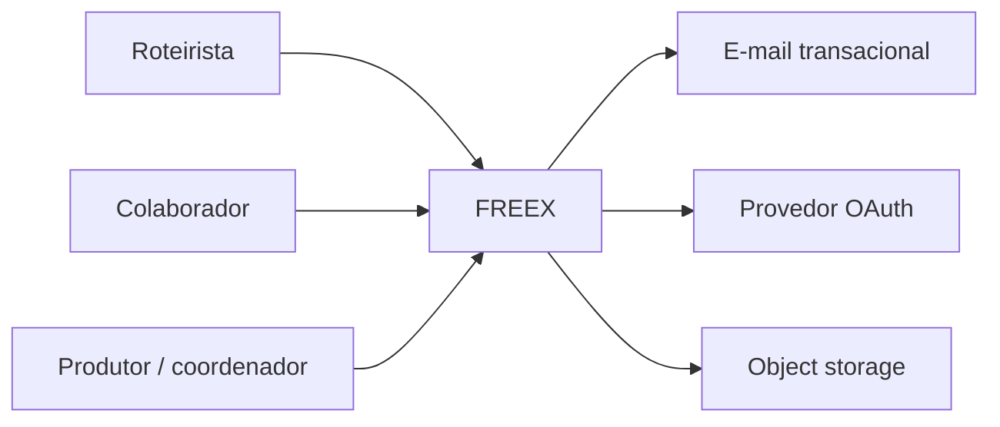
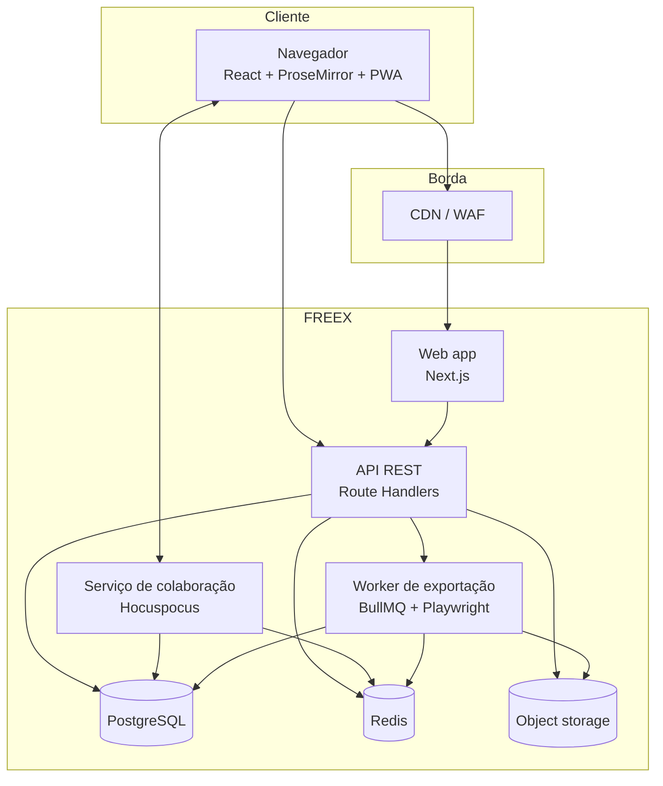
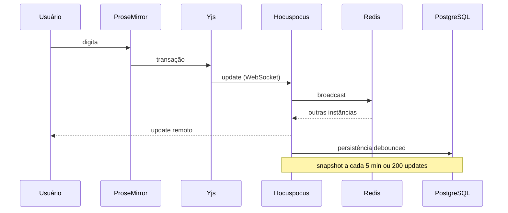
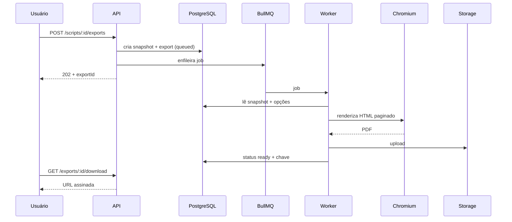
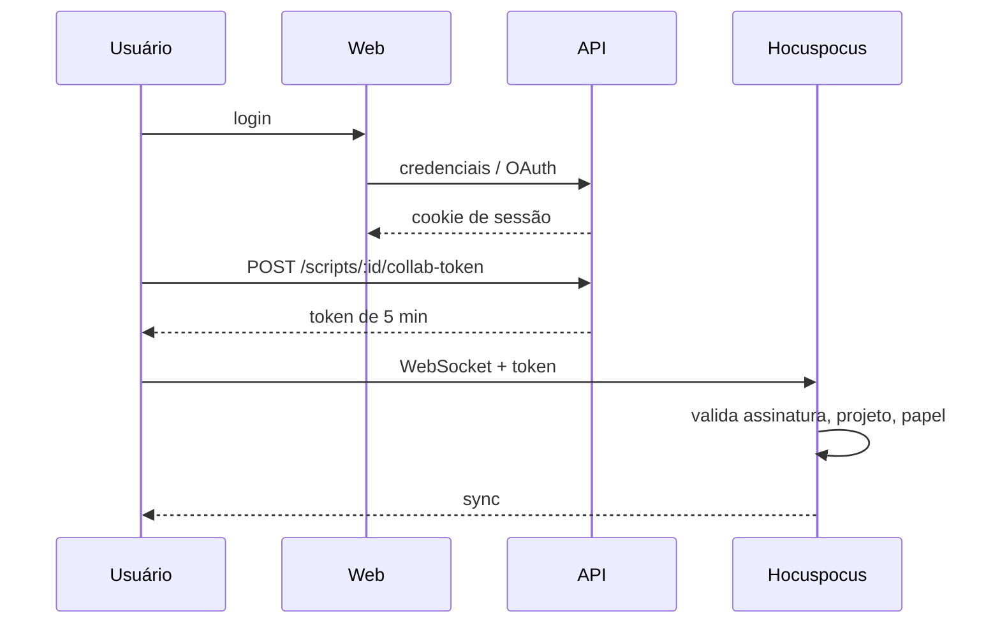

# Arquitetura geral

**Status:** proposta técnica para a fase 1  
**Relaciona-se com:** [`modelo-de-dados.md`](modelo-de-dados.md), [`api.md`](api.md), [`colaboracao-tempo-real.md`](colaboracao-tempo-real.md), [`exportacao-pdf.md`](exportacao-pdf.md)

---

## 1. Objetivo

Definir a arquitetura do FREEX de forma que:

- a formatação tenha uma única fonte de verdade;
- a colaboração em tempo real escale sem conflitos;
- a exportação de PDF seja fiel, assíncrona e observável;
- o sistema possa começar simples e crescer sem reescrita;
- cada componente tenha um limite claro de responsabilidade.

## 2. Princípios

1. **Um motor de layout.** Prévia, editor paginado e PDF usam o mesmo código.
2. **Monólito modular para CRUD.** Não dividir em microsserviços o que ainda cabe em um deploy.
3. **Serviços separados para o que é stateful ou pesado.** Colaboração e renderização de PDF têm ciclos de vida diferentes.
4. **Snapshots para tudo que é imutável.** Exportação, versão e auditoria partem de um estado congelado.
5. **Autorização no servidor.** A interface esconde; o servidor impede.
6. **Assíncrono por padrão.** Tarefas que passam de 2 segundos viram job.
7. **Falha explícita.** Nenhum componente inventa resultado, fonte ou página.
8. **Observabilidade desde o primeiro deploy.** Logs, métricas e traces não são fase 4.

## 3. Stack de referência

| Camada | Escolha | Motivo |
|---|---|---|
| Runtime | Node.js 22 LTS | Ecossistema, suporte, estabilidade |
| Gerenciador | pnpm + Turborepo | Monorepo rápido, cache de tarefas |
| Frontend | Next.js 15 (App Router), React 19 | SSR, rotas, integração com API |
| Entrega | Web responsiva + PWA | Instalação e shell offline em desktop e mobile, sem app nativo |
| Linguagem | TypeScript estrito | Segurança de tipos no domínio |
| Editor | ProseMirror + `y-prosemirror` | Schema customizado, controle de transações, CRDT |
| CRDT | Yjs | Convergência, offline, maturidade |
| WebSocket | Hocuspocus | Servidor Yjs, autenticação, extensões |
| API | Next.js Route Handlers | Menos infraestrutura no MVP; extraível depois |
| Banco | PostgreSQL 16 | Transações, JSONB, integridade relacional |
| ORM | Drizzle ORM | SQL explícito, migrações versionadas |
| Cache/fila | Redis 7 + BullMQ | Pub/sub, rate limit, jobs |
| Storage | S3-compatível (R2/S3) | PDFs, avatares, exports |
| Auth | Better Auth com schema próprio e integração Drizzle | E-mail/senha, OAuth, cookies e integração com Next |
| UI | Tailwind CSS + Radix UI | Acessibilidade, consistência |
| Validação | Zod | Contratos em runtime e tipos |
| PDF | Playwright + Chromium fixado | Fidelidade visual, fonte incorporada |
| Observabilidade | OpenTelemetry + Sentry + Pino | Traces, erros, logs estruturados |
| Testes | Vitest, Playwright, Testcontainers, k6 | Unidade, E2E, integração, carga |
| Deploy | Docker; web em Vercel/Fly, serviços em Fly/Render | Flexibilidade e proximidade |

As escolhas não são irreversíveis. As decisões estruturais estão nos ADRs.

## 4. Contexto



## 5. Containers



### 5.1 Web app

- Renderiza a interface.
- Faz autenticação e sessão com Better Auth, atrás dos endpoints públicos `/v1/auth/*`; o contrato REST não expõe os endpoints nativos da biblioteca.
- Serve a API REST.
- Serve o shell PWA e o editor; em telas estreitas, a edição usa o modo linear e a prévia paginada consome o mesmo layout do PDF.
- O service worker cacheia apenas shell, assets estáticos e fonte. Conteúdo de roteiro fica no IndexedDB por usuário; respostas autenticadas de API e PDF não entram no cache.
- Não guarda estado de documento em memória.
- Pode ser replicada horizontalmente sem sticky session.

### 5.2 Serviço de colaboração

- Mantém as salas Yjs em memória.
- Autentica conexões WebSocket.
- Sincroniza atualizações entre instâncias via Redis.
- Persiste o estado do documento no PostgreSQL.
- Emite presença e cursores via awareness.
- É stateful: cada sala vive em uma instância, mas o Redis propaga as atualizações.

### 5.3 Worker de exportação

- Consome jobs da fila.
- Lê um snapshot imutável do banco.
- Renderiza o PDF com Chromium fixado.
- Faz upload para o storage.
- Atualiza o status da exportação.
- É horizontalmente escalável; a concorrência é limitada por memória.

### 5.4 PostgreSQL

- Fonte de verdade de contas, projetos, permissões, metadados, snapshots, comentários e exportações.
- Guarda o estado Yjs mais recente e os snapshots históricos.
- Não guarda PDFs; guarda a chave do objeto.

### 5.5 Redis

- Pub/sub do Hocuspocus.
- Filas BullMQ.
- Rate limiting.
- Cache de sessão e de tokens de colaboração.
- Não é fonte de verdade. Perder Redis não pode perder documento.

### 5.6 Object storage

- PDFs exportados.
- Avatares.
- Anexos futuros.
- Acesso por URL assinada, com expiração.

## 6. Módulos e dependências

```text
apps/
  web/          Next.js: UI, API, auth
  collab/       Hocuspocus
  worker/       BullMQ + PDF

packages/
  screenplay/   schema, elementos, constantes, comandos, validação
  layout/       motor de paginação e coordenadas
  pdf/          renderização e pós-processamento
  contracts/    Zod + OpenAPI + tipos de API
  db/           schema Drizzle, migrações, repositórios
  auth/         sessão, papéis, políticas
  ui/           design system
  observability/logs, métricas, traces
  config/       eslint, tsconfig, env
  test/         fixtures e helpers
```

Regras de dependência:

- `screenplay` não depende de app, banco ou UI.
- `layout` depende apenas de `screenplay`.
- `pdf` depende de `layout` e `screenplay`.
- `web` depende de `contracts`, `db`, `auth`, `ui`, `screenplay`, `layout`.
- `collab` depende de `screenplay`, `db`, `auth`, `observability`.
- `worker` depende de `pdf`, `db`, `observability`.
- Nenhum pacote de domínio importa código de `apps/`.
- Nenhum componente de UI importa `db` diretamente.

## 7. Fluxos principais

### 7.1 Edição e sincronização



### 7.2 Exportação



### 7.3 Autenticação e colaboração



## 8. Modelo de consistência

| Dado | Consistência | Fonte de verdade |
|---|---|---|
| Texto do roteiro | Eventual, convergente (CRDT) | Yjs + snapshots |
| Permissões | Forte | PostgreSQL |
| Metadados de projeto | Forte | PostgreSQL |
| Comentários | Forte para o registro; eventual para o anchor | PostgreSQL + posições relativas |
| Exportação | Forte no snapshot | PostgreSQL + storage |
| Presença | Efêmera | Awareness + Redis |
| Sessão | Forte | PostgreSQL/Redis |

A edição é eventualmente consistente por natureza. O usuário pode ver uma edição remota com atraso de rede, mas o estado converge. Permissões e exportações não podem ser eventuais: uma exportação nunca usa um estado "quase" salvo.

## 9. Escala

### 9.1 Web

- Stateless; escala horizontal.
- Sessão em cookie; nenhum estado local obrigatório.
- CDN para assets estáticos.
- Rate limit no edge e na API.

### 9.2 Colaboração

- Uma sala por roteiro.
- 50 conexões simultâneas por roteiro no MVP.
- Redis pub/sub para múltiplas instâncias.
- Persistência debounced; snapshots periódicos.
- Limite de tamanho de documento e de mensagem.
- No MVP, o documento não é dividido; o limite de 300 páginas é suficiente.

### 9.3 PDF

- Fila com concorrência configurável.
- 1 job = 1 processo Chromium isolado ou contexto isolado.
- Limite de 300 páginas e 120 s.
- Cache por hash de snapshot + opções.
- Retry 3 vezes com backoff; depois dead-letter.

### 9.4 Banco

- Connection pooling.
- Índices para listagens e permissões.
- Partição de `script_updates` por mês, se o volume justificar.
- Réplica de leitura para listagens e relatórios, se necessário.

## 10. Falhas e degradação

| Componente | Falha | Comportamento |
|---|---|---|
| PostgreSQL | Indisponível | API retorna 503; colaboração continua em memória com aviso e buffer; novas sessões bloqueadas; alerta crítico |
| Redis | Indisponível | Colaboração perde pub/sub entre instâncias; fila pausa; rate limit degrada; modo de instância única com aviso |
| Hocuspocus | Indisponível | Editor entra em modo offline; edições vão para IndexedDB; reconexão automática |
| Worker | Indisponível | Exportações ficam `queued`; usuário vê status; alerta de backlog |
| Storage | Indisponível | Exportação falha após retries; download retorna erro claro; jobs reenfileirados |
| E-mail | Indisponível | Convites e recuperação ficam pendentes; link copiável na interface |
| Chromium | Crash | Job falha, retry; se persistir, dead-letter e alerta |
| CDN | Indisponível | Web app ainda serve via origem, com latência maior |

### 10.1 Regra de ouro

Nenhuma falha de componente pode resultar em perda silenciosa de texto. Se o sistema não consegue persistir, ele deve dizer isso ao usuário e manter uma cópia local até conseguir.

## 11. Segurança de borda

- WAF/CDN na frente de web e API.
- TLS 1.3.
- CORS restrito ao domínio da aplicação.
- CSP estrita.
- Rate limit por IP, sessão e conta.
- WebSocket com origem verificada e token de curta duração.
- Uploads com validação de tipo e tamanho.
- Nenhum acesso direto ao banco ou ao storage a partir do navegador.

## 12. Ambientes

| Ambiente | Objetivo | Dados |
|---|---|---|
| Local | Desenvolvimento | Fixtures sintéticas |
| Preview | Revisão de PR | Efêmero, isolado |
| Staging | Ensaio de release | Cópia anonimizada |
| Produção | Usuários | Dados reais |

- Migrações rodam em job separado, antes do deploy.
- Feature flags controlam liberação.
- Segredos vêm de secret manager, nunca do repositório.
- Preview não acessa produção.

## 13. Estrutura de repositório

```text
freex/
  apps/
    web/
    collab/
    worker/
  packages/
    screenplay/
    layout/
    pdf/
    contracts/
    db/
    auth/
    ui/
    observability/
    config/
    test/
  infra/
    docker/
    migrations/
    terraform/       (se aplicável)
  docs/
  README.md
  AGENTS.md
  package.json
  pnpm-workspace.yaml
  turbo.json
```

## 14. Decisões e alternativas

| Decisão | Alternativa rejeitada | Motivo |
|---|---|---|
| Yjs + Hocuspocus | OT proprietário | Maturidade, offline, ecossistema |
| ProseMirror | Editor de texto simples | Schema, transações, colaboração |
| Chromium para PDF | PDFKit | Fidelidade visual, Unicode, uma única composição |
| Postgres | Document DB | Relações, transações, integridade |
| Monólito modular | Microsserviços desde o início | Custo operacional, velocidade |
| Redis | Apenas Postgres | Pub/sub e fila eficientes |
| US Letter | A4 como padrão | Padrão de submissão internacional |

O contexto completo, as alternativas e as consequências de cada decisão estão nos ADRs: [ADR-001](adr/ADR-001-colaboracao-crdt.md), [ADR-002](adr/ADR-002-editor-prosemirror.md), [ADR-003](adr/ADR-003-pdf-chromium.md), [ADR-004](adr/ADR-004-paper-letter.md) e [ADR-005](adr/ADR-005-monolito-modular.md).

## 15. Riscos arquiteturais

| Risco | Mitigação |
|---|---|
| Complexidade do CRDT | Biblioteca madura, testes de convergência, limites claros |
| Divergência de layout | Motor único, testes golden, Chromium fixado |
| Custo de Chromium | Cache, concorrência limitada, pool de contextos |
| Acoplamento ao provedor | Interfaces de storage, fila e e-mail |
| Vazamento de dados entre projetos | Autorização central, testes de isolamento |
| Aumento do tempo de exportação | Jobs assíncronos, limites, monitoramento |

## 16. Critérios de aceite da arquitetura

- Um roteiro de 120 páginas abre, edita e exporta dentro das metas.
- Duas instâncias de colaboração sincronizam o mesmo roteiro.
- Uma queda do worker não perde jobs.
- Uma queda do Redis não perde texto.
- Um PDF usa o mesmo layout da prévia.
- Nenhum endpoint permite acesso a projeto sem vínculo.
- Todos os componentes emitem logs, métricas e traces.
- O ambiente local sobe com um comando documentado.

## 17. Referências

- Colaboração: [`colaboracao-tempo-real.md`](colaboracao-tempo-real.md)
- PDF: [`exportacao-pdf.md`](exportacao-pdf.md)
- Dados: [`modelo-de-dados.md`](modelo-de-dados.md)
- API: [`api.md`](api.md)
- Segurança: [`seguranca-e-privacidade.md`](seguranca-e-privacidade.md)
- ADRs: [`adr/`](adr/)
