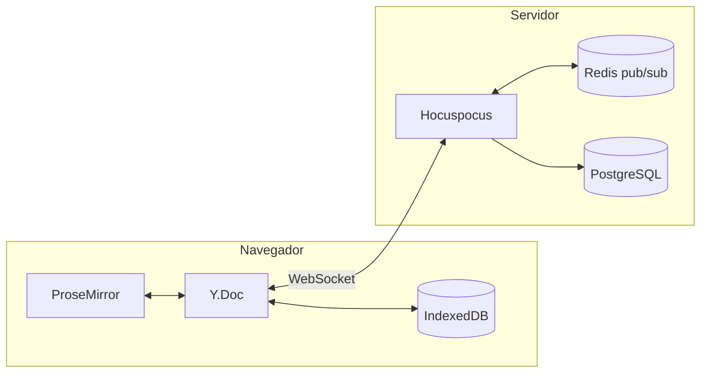

# Colaboração em tempo real

**Status:** proposta técnica para a fase 2  
**Tecnologias:** Yjs, Hocuspocus, Redis, PostgreSQL  
**Relaciona-se com:** [`arquitetura-geral.md`](arquitetura-geral.md), [`modelo-de-dados.md`](modelo-de-dados.md), [`api.md`](api.md), [`ADR-001`](adr/ADR-001-colaboracao-crdt.md)

---

## 1. Objetivo

Permitir que várias pessoas editem o mesmo roteiro ao mesmo tempo, com:

- convergência sem conflitos manuais;
- presença e cursores;
- permissões aplicadas no servidor;
- funcionamento offline com sincronização posterior;
- histórico de versões;
- limites claros de escala e abuso.

## 2. Por que CRDT

### 2.1 O problema

Edição colaborativa pode ser resolvida de três formas:

| Modelo | Como funciona | Problema |
|---|---|---|
| Travamento | Só um edita por vez | Ruim para escrita a quatro mãos |
| OT (Operational Transformation) | Servidor transforma operações concorrentes | Exige servidor central autoritativo e é complexo de operar |
| CRDT (Conflict-free Replicated Data Type) | Réplicas convergem sem coordenação central | Metadados maiores, necessário validar estrutura |

O FREEX escolhe CRDT porque:

- permite edição offline;
- não exige um único servidor autoritativo por documento;
- escala horizontalmente com Redis;
- tem biblioteca madura (Yjs) e integração com ProseMirror.

### 2.2 O que CRDT não resolve

CRDT garante convergência de texto, não garante semântica de estrutura. Duas pessoas podem, ao mesmo tempo:

- dividir o mesmo bloco de fala;
- apagar o personagem de uma fala enquanto outra adiciona diálogo;
- transformar um bloco em diálogo duplo enquanto outra edita uma das colunas.

Esses casos exigem regras de normalização e validação. A seção 9 trata disso.

## 3. Estrutura do documento Yjs

### 3.1 Um documento por roteiro

- `Y.Doc` com nome lógico `script:{scriptId}`.
- Uma sala por roteiro.
- O documento contém um `Y.XmlFragment('content')` que representa a árvore ProseMirror.
- Um `Y.Map('meta')` guarda `schemaVersion` e um `updatedBy` opcional.
- Comentários NÃO ficam no Y.Doc; ficam no PostgreSQL, com âncoras de posição relativa.

```text
Y.Doc
├── XmlFragment "content"
│   ├── scene_heading
│   ├── action
│   ├── speech
│   │   ├── character
│   │   └── dialogue
│   └── transition
└── Map "meta"
    └── schemaVersion
```

### 3.2 Binding com ProseMirror

- `ySyncPlugin` sincroniza o documento.
- `yCursorPlugin` publica seleção e cursor.
- `yUndoPlugin` mantém undo local por usuário.
- O schema ProseMirror é a autoridade de estrutura no cliente.
- Toda mutação passa por uma transação ProseMirror. Nenhum código de UI mexe no `Y.Doc` diretamente.

### 3.3 Por que não usar um `Y.Text` único

Um `Y.Text` com o roteiro inteiro seria simples, mas perderia a estrutura de elementos. O layout, a validação e a exportação precisam saber o tipo de cada bloco. A árvore XML preserva tipos e atributos e permite operações atômicas por elemento.

## 4. Arquitetura de sincronização



### 4.1 Handshake

1. O cliente obtém um token de colaboração em `POST /v1/scripts/:id/collab-token`.
2. Abre WebSocket para o serviço de colaboração.
3. Envia mensagem de autenticação com o token.
4. O servidor valida assinatura, expiração, `scriptId`, `projectId` e papel.
5. O servidor carrega o estado do documento (ou cria vazio).
6. Cliente e servidor trocam `sync step 1` e `sync step 2`.
7. Awareness é enviado.
8. A edição começa.

### 4.2 Token

Payload:

```json
{
  "iss": "https://api.freex.app",
  "aud": "freex-collab",
  "sub": "user_uuid",
  "projectId": "project_uuid",
  "scriptId": "script_uuid",
  "role": "editor",
  "jti": "token_uuid",
  "exp": 1760000000,
  "iat": 1759999700
}
```

- TTL: 5 minutos.
- Assinatura: EdDSA (Ed25519) ou HS256 com segredo rotacionado.
- Enviado na mensagem de autenticação do Hocuspocus, não na query string.
- O servidor verifica a assinatura e consulta o banco para confirmar que o vínculo ainda existe.
- Um token de `viewer` abre conexão somente leitura.

### 4.3 Protocolo

O FREEX usa o protocolo do Hocuspocus, não um protocolo próprio. As mensagens relevantes:

| Mensagem | Função |
|---|---|
| `Authenticate` | Token e identificação do cliente |
| `SyncStep1` | Envia vetor de estado |
| `SyncStep2` | Envia atualizações faltantes |
| `Update` | Atualização incremental |
| `Awareness` | Presença, cursor, seleção |
| `Stateless` | Eventos customizados (comentários, permissões) |
| `Ping/Pong` | Heartbeat |

Regras:

- Tamanho máximo de mensagem: 1 MB.
- Frequência máxima por conexão: 100 mensagens/s.
- Heartbeat: 30 s.
- Timeout de conexão ociosa: 120 s.
- Reconexão: backoff exponencial de 1 s a 30 s, com jitter.
- `documentName` deve seguir `script:{uuid}`; qualquer outro formato é rejeitado.

## 5. Presença e cursores

### 5.1 Awareness

Cada conexão publica:

```json
{
  "user": {
    "id": "user_uuid",
    "name": "Ana Silva",
    "color": "#2563EB",
    "avatarUrl": "https://..."
  },
  "cursor": { "anchor": "...", "head": "..." },
  "selection": { "from": 42, "to": 57 },
  "activeElementId": "element_uuid",
  "lastActiveAt": "2026-10-23T14:00:00Z"
}
```

- Cursor e seleção usam posições relativas do Yjs, não índices absolutos.
- A cor é atribuída por usuário, com paleta fixa e contraste garantido.
- Nome e avatar são truncados e sanitizados.
- Awareness não é persistido; é efêmero.
- Atualizações de cursor são limitadas a 50 ms (20 Hz).
- Usuário inativo há 30 s fica com presença esmaecida; há 5 min é removido da lista.

### 5.2 Múltiplas abas

- A mesma pessoa pode ter várias abas.
- A UI agrupa por `userId` e mostra "2 abas" quando necessário.
- Cada aba tem um `clientId` Yjs próprio.
- O undo é por aba, não por pessoa.

### 5.3 Privacidade

- A presença mostra apenas nome, avatar e cor.
- Não mostra e-mail, papel ou ID interno.
- O cursor de um `viewer` não é editável, mas pode ser exibido.
- O usuário PODE ocultar a própria presença (modo invisível) em uma fase futura.

## 6. Persistência

### 6.1 Estado atual

- `script_documents.state` guarda o estado Yjs completo (`Y.encodeStateAsUpdate`).
- `script_documents.last_seq` guarda a última sequência aplicada.
- Na abertura de uma sala, o servidor carrega o estado; se não existir, cria um documento vazio a partir do título.

### 6.2 Log de atualizações

- `script_updates` recebe cada atualização com `seq` monotônico.
- O log serve para recuperação, depuração e auditoria técnica.
- É append-only e não substitui o snapshot.
- Retenção: 30 dias após o snapshot, ou último 10.000 updates.

### 6.3 Debounce e snapshot

- Persistência do estado completo: debounce de 2 s após a última atualização.
- Snapshot automático: a cada 5 min de atividade ou 200 atualizações, o que ocorrer primeiro.
- Snapshot manual: ação do usuário.
- Snapshot de exportação: criado no momento do pedido, imutável.
- Snapshot de restauração: criado antes de aplicar a restauração.

### 6.4 Compactação

1. Snapshot é gravado.
2. Updates anteriores ao snapshot são elegíveis para remoção.
3. Job diário remove updates além da retenção.
4. O estado em `script_documents` permanece como base.

### 6.5 Recuperação

- Se o processo cair, a sala é recarregada do banco na próxima conexão.
- Se o banco estiver indisponível, a sala continua em memória e tenta persistir.
- Se o processo cair sem persistir, o cliente ainda tem o estado no IndexedDB e pode reenviar ao reconectar.
- Se o cliente também perdeu o estado, o RPO de 5 min se aplica.

## 7. Offline e reconexão

### 7.1 Persistência local

- `y-indexeddb` guarda o documento no navegador.
- O estado local é a réplica do usuário.
- Ao abrir offline, o editor funciona em modo somente local.
- A UI mostra "Offline — alterações serão sincronizadas".
- No mobile, o navegador pode suspender a aba; a sincronização em segundo plano não é prometida. Ao voltar, o cliente reconecta e aplica o estado local antes de enviar alterações.

### 7.2 Reconexão

1. O cliente detecta a queda.
2. Entra em modo offline; edições continuam.
3. Tenta reconectar com backoff.
4. No handshake, envia `SyncStep1`.
5. O servidor responde com o que falta.
6. O cliente envia o que o servidor não tem.
7. As réplicas convergem.
8. A UI mostra "Sincronizado".

### 7.3 Conflitos

Não há diálogo de "escolha uma versão". O CRDT resolve texto. Para estrutura, a normalização da seção 9 resolve. O usuário vê o resultado, não um conflito.

### 7.4 Limpeza local

- Logout limpa IndexedDB após confirmar que não há alterações pendentes.
- Se houver pendências, a UI avisa e oferece exportar ou aguardar.
- Em dispositivo compartilhado, o usuário PODE desativar cache offline nas configurações.

### 7.5 Schema antigo

- Se o cliente tem schema anterior ao do servidor, a edição é bloqueada.
- A UI pede para atualizar a página.
- O servidor migra o documento ao abrir.
- Nunca aplicar uma atualização de schema incompatível em uma sala ativa.

## 8. Permissões em tempo real

### 8.1 Papéis

| Papel | Conecta? | Lê? | Edita? | Comenta? |
|---|---|---|---|---|
| owner | Sim | Sim | Sim | Sim |
| editor | Sim | Sim | Sim | Sim |
| commenter | Sim | Sim | Não | Sim |
| viewer | Sim | Sim | Não | Não |

### 8.2 Aplicação

- `onAuthenticate` valida o token e consulta o banco.
- `connection.readOnly = true` para `viewer` e `commenter`.
- O servidor rejeita mensagens `Update` de conexões somente leitura.
- A UI esconde controles, mas a decisão é do servidor.
- Mudança de papel publica um evento `permission.changed` no Redis.
- O serviço atualiza a conexão ou a encerra, conforme o caso.
- Remoção de membro encerra todas as conexões daquele usuário no projeto.

### 8.3 Links de leitura

- Token de link contém `linkId`, `scriptId`, `role=viewer`, `exp`.
- Não exige conta, mas exige token válido.
- Revogação é imediata: o servidor consulta o estado do link.
- Links expiram por padrão em 7 dias.
- Não permitem comentários, a menos que o criador habilite.

## 9. Integridade estrutural

### 9.1 Problema

Yjs converge o texto, mas duas operações concorrentes podem produzir uma árvore inválida:

- `speech` sem `character`;
- `speech` sem `dialogue`;
- `parenthetical` depois do diálogo;
- `dual_dialogue` com uma coluna;
- dois `character` no mesmo `speech`;
- nó vazio.

### 9.2 Prevenção

- Comandos ProseMirror encapsulam operações estruturais.
- Operações de divisão e junção de fala são transações atômicas.
- O schema impede a maioria das mutações inválidas no cliente.
- O servidor valida o JSON no snapshot.

### 9.3 Normalização

Após aplicar atualizações remotas, o cliente executa uma passagem de normalização:

1. Remover nós vazios.
2. Garantir que `speech` tenha `character` e pelo menos um `dialogue`.
3. Mover `parenthetical` para antes do primeiro `dialogue`.
4. Se `dual_dialogue` tiver menos de duas `speech`, converter para `speech` simples.
5. Se `dual_dialogue` tiver mais de duas, manter as duas primeiras e converter o resto.
6. Mesclar textos adjacentes do mesmo tipo.
7. Reordenar `character` para o início do `speech`.

A normalização é idempotente e determinística.

### 9.4 Quarentena

Se o servidor detectar um snapshot inválido:

1. Não sobrescrever o último snapshot válido.
2. Marcar a sala como `quarantined`.
3. Notificar o time.
4. Permitir leitura.
5. Bloquear edição até intervenção.
6. Restaurar o último snapshot válido, se necessário.

Isso é raro e deve ser tratado como incidente, não como fluxo normal.

### 9.5 Testes de concorrência

- Duas réplicas dividem a mesma fala.
- Uma apaga o personagem enquanto a outra adiciona diálogo.
- Uma cria diálogo duplo enquanto a outra edita uma coluna.
- Uma restaura uma versão enquanto a outra digita.
- Três réplicas editam o mesmo parágrafo.
- Cliente offline por 30 min e reconexão.

## 10. Comentários ancorados

### 10.1 Armazenamento

- Comentários ficam no PostgreSQL.
- O anchor é uma posição relativa do Yjs codificada em `bytea`.
- `selected_text` guarda o texto no momento da criação.
- Se o anchor não resolver, o comentário fica órfão, mas não desaparece.

### 10.2 Criação

1. Usuário seleciona um trecho.
2. Cliente cria `RelativePosition` de início e fim.
3. `POST /v1/scripts/:id/comments` envia anchor, texto e corpo.
4. Servidor valida permissão e grava.
5. Servidor publica `comment.created` no canal `script:{id}:events`.
6. Hocuspocus repassa via `Stateless` para as conexões da sala.
7. Clientes atualizam a lista.

### 10.3 Edição do texto

- O anchor acompanha a edição.
- Se o trecho for apagado, o anchor resolve para nulo.
- O comentário é marcado como órfão.
- A UI mostra "Trecho original removido" e mantém a thread.

### 10.4 Resolução

- Resolver muda `status` para `resolved`.
- A thread sai da lista ativa.
- Reabrir volta para `open`.
- O histórico de resolução fica em `audit_events`.

### 10.5 Permissões

- `owner`, `editor`, `commenter` criam e respondem.
- `viewer` não cria.
- Autor pode editar o próprio comentário por 15 min; depois, apenas excluir (soft delete) ou responder.
- `owner` pode excluir qualquer comentário do projeto.

## 11. Histórico de versões

### 11.1 Tipos

| Tipo | Quando | Retenção |
|---|---|---|
| `auto` | A cada 5 min ou 200 updates | 90 dias |
| `manual` | Usuário nomeia | Vida do projeto |
| `export` | No pedido de exportação | 7 dias após o PDF |
| `restore` | Antes de restaurar | Vida do projeto |

### 11.2 Restauração

1. Usuário escolhe uma versão.
2. Servidor cria um snapshot `restore` do estado atual (segurança).
3. Servidor carrega o estado da versão escolhida.
4. Aplica uma transação que substitui o conteúdo do documento.
5. A sala converge para o novo conteúdo.
6. A UI mostra um banner "Versão restaurada; desfaça se necessário".
7. O histórico anterior permanece.

A restauração não é um `git reset`. Ela cria um novo estado e preserva o passado.

### 11.3 Diff

- Comparação estrutural entre `document_json` de duas versões.
- Mostra blocos adicionados, removidos e alterados.
- Não é um diff de caracteres; é um diff de elementos.
- O diff é calculado no servidor e enviado à UI.

## 12. Limites e desempenho

| Limite | Valor |
|---|---|
| Conexões simultâneas por roteiro | 50 |
| Tamanho de mensagem | 1 MB |
| Mensagens por segundo por conexão | 100 |
| Tamanho de texto por roteiro | 5 MB |
| Páginas por roteiro | 300 |
| Membros por projeto | 100 |
| Documentos abertos por instância | Configurável; monitorar memória |
| Latência de propagação p95 | 300 ms na mesma região |
| Latência de tecla p95 | 50 ms no cliente |

### 12.1 Memória

- Medir o consumo por sala de 120 páginas.
- Metas iniciais: menos de 50 MB por sala, 2.000 salas por instância de 8 GB.
- Se a meta não for atingida, reduzir salas por instância ou aumentar recursos.
- Não usar cache de documento sem limite.

### 12.2 Backpressure

- Se a fila de mensagens de uma conexão crescer, o servidor aplica backpressure.
- Se o cliente não acompanhar, a conexão é encerrada com código claro.
- Atualizações são agrupadas em intervalos de 16–50 ms, conforme o ambiente.

## 13. Falhas

| Falha | Comportamento |
|---|---|
| Redis indisponível | Edições na mesma instância continuam; pub/sub entre instâncias para; alerta; novas conexões podem ser roteadas para uma instância única |
| PostgreSQL indisponível | Sala continua em memória; persistência falha; UI mostra "não salvo"; cliente mantém cópia local; alerta |
| Hocuspocus reinicia | Clientes reconectam; sala recarrega do banco; sync converge |
| Cliente fica offline | Modo offline; IndexedDB; sync ao voltar |
| Cliente fecha sem sincronizar | Estado local permanece; ao abrir, sync envia o que falta |
| Mensagem inválida | Conexão encerrada ou mensagem descartada; log sem conteúdo |
| Token expirado | Cliente renova via API; reconecta |
| Permissão revogada | Conexão encerrada ou rebaixada; UI informa |

### 13.1 Regra de ouro

O texto nunca deve ser perdido silenciosamente. Se o servidor não consegue persistir, o cliente precisa saber e manter a cópia local até conseguir.

## 14. Segurança

- Token de curta duração, com `jti` e `aud`.
- Verificação de origem no handshake.
- Rate limit por IP, usuário e documento.
- Sem confiança no `role` enviado pelo cliente; sempre consultar o banco.
- Awareness sanitizado.
- Nenhum HTML do usuário é renderizado como HTML.
- Subdocumentos Yjs desabilitados.
- Mensagens grandes ou malformadas são rejeitadas antes de aplicar.
- Logs não contêm texto do roteiro.
- Conexões administrativas são auditadas.

## 15. Observabilidade

### 15.1 Métricas

- conexões ativas por instância;
- salas ativas;
- updates por segundo;
- latência de propagação;
- lag de persistência;
- duração de snapshot;
- falhas de autenticação;
- mensagens rejeitadas;
- uso de memória por sala;
- lag de pub/sub do Redis.

### 15.2 Logs

Eventos estruturados:

- `collab.connection.opened`;
- `collab.connection.closed`;
- `collab.auth.failed`;
- `collab.persistence.failed`;
- `collab.snapshot.created`;
- `collab.schema.invalid`;
- `collab.permission.changed`.

Campos: `script_id`, `project_id`, `user_id`, `connection_id`, `duration_ms`, `error_code`. Nunca o texto.

### 15.3 Traces

- handshake;
- sync;
- persistência;
- snapshot;
- broadcast.

## 16. Testes

### 16.1 Convergência

- Duas réplicas, operações concorrentes, estado final igual.
- Três réplicas, operações aleatórias, propriedade de convergência.
- 1.000 operações por réplica, sem divergência.

### 16.2 Offline

- Cliente offline por 1 min, 10 min e 30 min.
- Reconexão com edições dos dois lados.
- Fechar e reabrir o navegador.
- Limpar cache local com pendências.

### 16.3 Permissões

- `viewer` tenta enviar update; servidor rejeita.
- `commenter` tenta editar; servidor rejeita.
- Mudança de papel em sessão ativa.
- Remoção de membro em sessão ativa.
- Token expirado e renovação.

### 16.4 Estrutura

- Divisão concorrente de fala.
- Junção concorrente.
- Diálogo duplo concorrente.
- Restauração durante edição.
- Normalização idempotente.

### 16.5 Carga

- 50 clientes no mesmo roteiro.
- 10.000 updates em 5 min.
- 2.000 salas por instância.
- Latência p95 dentro da meta.
- Memória dentro da meta.

### 16.6 Caos

- Matar Redis.
- Matar PostgreSQL.
- Matar Hocuspocus.
- Latência de rede.
- Perda de pacotes.

## 17. Critérios de aceite

- Duas sessões editam o mesmo roteiro e convergem.
- Um `viewer` não consegue editar, nem com cliente modificado.
- Um cliente offline por 10 min reconecta sem perder texto.
- Um comentário sobrevive a uma edição ao redor.
- Uma restauração não apaga o histórico.
- 50 conexões simultâneas funcionam dentro da meta.
- Redis e PostgreSQL podem cair sem perda silenciosa.
- O servidor não confia em papel enviado pelo cliente.
- Nenhum texto de roteiro aparece em logs.
- Testes de concorrência e caos passam.

## 18. Implementação atual: link de edição sem conta

**Status:** implementado em `apps/collab` e `apps/web` (FR-COL-016). É a primeira fatia da colaboração, feita antes de contas, banco e Redis. As seções 1 a 17 continuam sendo o alvo; esta seção diz o que existe e onde ele se afasta delas.

### 18.1 Fluxo

1. Na página inicial, **Compartilhar** envia o roteiro e a capa para `POST /v1/shares` (serviço de colaboração, validado com Zod) e recebe um `token` de 256 bits.
2. O navegador abre `/s#<token>`. O token está no fragmento: não vai ao servidor web, a log nem a `Referer`.
3. A página calcula `docId = SHA-256(token)` e conecta ao WebSocket com `name = docId` e `token` na mensagem de autenticação do Hocuspocus (nunca na URL).
4. O servidor confere `docId == SHA-256(token)` e se a sala existe. Qualquer falha dá a mesma resposta, sem dizer o que existe.
5. A pessoa informa um nome antes de editar. Sem nome o texto aparece, mas o editor, a barra de ferramentas e a capa ficam bloqueados.
6. Todos editam o mesmo `Y.Doc`. O diálogo de compartilhar mostra o link e o avisa que qualquer pessoa com ele edita.

### 18.2 Estrutura do `Y.Doc`

| Tipo | Conteúdo |
|---|---|
| `XmlFragment "content"` | A árvore ProseMirror do `scriptSchema` (seção 3) |
| `Map "cover"` | Os campos da capa (`CoverFields`); cada campo é escrito separadamente, então duas pessoas editando campos diferentes não se sobrescrevem |
| `Map "meta"` | `schemaVersion` |
| `Map "contributors"` | Nome → `{ at }`: quem editou e quando (no máximo 200 nomes, no máximo uma escrita a cada 5 s por pessoa) |

Os nomes dos tipos vêm de `COLLAB_TYPES` em `packages/contracts`, para o servidor e o navegador usarem a mesma fonte. As quebras de página, o número e `(MORE)`/`(CONT'D)` **não** vão para o `Y.Doc`: cada navegador as calcula com o mesmo paginador, então todos veem as mesmas páginas.

### 18.3 Presença

A presença é `{ user: { name, color }, cursor }`. O servidor reescreve cada estado antes de repassá-lo (`beforeHandleAwareness`): mantém só um nome limpo (`sanitizeParticipantName`: NFC, sem controles nem caracteres bidi, 30 caracteres), uma cor `#rrggbb` e o cursor; qualquer outro campo é descartado. Quem não tem nome não aparece. O cliente repete a limpeza ao desenhar. A cor de cada pessoa sai de uma paleta fixa de 8 cores, todas com contraste de 4,5:1 com texto branco, escolhida pelo hash do nome. Várias abas da mesma pessoa contam como uma pessoa.

### 18.3.1 Última modificação salva

A barra de status mostra "Última modificação salva às 14:32" (ontem, ou a data, quando for o caso), com a data completa no `title`. No roteiro compartilhado, o horário é o do **serviço**, não o do navegador: depois de cada gravação (`afterStoreDocument`) o servidor envia a todos da sala uma mensagem *stateless* `{"type":"saved","at":<ms>}` com o `mtime` do arquivo, e a envia também a quem acaba de conectar (`connected`), para que quem chega veja o horário já gravado. O cliente valida a mensagem (`parseSavedNotice`: JSON de até 200 caracteres, `at` inteiro positivo) e ignora qualquer outra. Enquanto há alterações ainda não enviadas (`unsyncedChanges`), aparece "Salvando…". No editor local, o horário é o da gravação do rascunho neste navegador ("… (neste navegador)"), guardado em `savedAt` no rascunho e atualizado só quando o conteúdo muda de fato.

### 18.4 Desfazer e estrutura

- Desfazer e refazer usam o `yUndoPlugin`: cada pessoa desfaz só o que escreveu.
- Os comandos estruturais (`Enter`, `Tab`, `Backspace`, diálogo duplo) reconstroem uma janela de blocos com o motor, mas aplicam só o trecho que mudou (`minimalReplace`): um `Enter` no fim de um bloco é uma inserção pura, e juntar dois blocos toca só esses dois. Assim não se apaga nem recria o texto que outra pessoa digita ao lado. O schema e a normalização (`normalizeBlocks`) garantem que o documento sempre seja válido, mesmo com edições concorrentes (seção 9).

### 18.5 Armazenamento e limites

| Item | Valor |
|---|---|
| Armazenamento | Um arquivo `<docId>.ydoc` por roteiro em `COLLAB_DATA_DIR` (padrão `.data/collab`), gravado em arquivo temporário e renomeado, com gravações serializadas por roteiro. Troca por PostgreSQL quando existir banco |
| Persistência | Debounce de 2 s, no máximo 10 s (seção 6.3); ao encerrar o servidor, grava tudo que estiver pendente |
| Mensagem | Até 1 MB (o WebSocket fecha com código 1009) |
| Taxa | 100 mensagens/s por conexão (fecha com 4429) |
| Sala | 50 conexões por roteiro; 60 conexões por endereço |
| Criação | 10 links por minuto por endereço; corpo até 3 MB |
| Origem | O `Origin` precisa estar em `WEB_ORIGIN` (CORS e WebSocket) |
| Ping | A cada 30 s |

Variáveis do serviço: `PORT` (3002), `HOST`, `COLLAB_DATA_DIR`, `WEB_ORIGIN` (lista separada por vírgulas), `MAX_CONNECTIONS_PER_DOC`, `MAX_CONNECTIONS_PER_IP`, `MESSAGES_PER_SECOND`, `CREATE_PER_MINUTE`. Variável do web: `NEXT_PUBLIC_COLLAB_URL` (padrão `http://localhost:3002`).

### 18.6 Diferenças em relação às seções 1 a 17

| Seção | O que diz | O que existe | Por quê |
|---|---|---|---|
| 4.2 | Token JWT com papel, TTL de 5 min, consultando o banco | Token opaco de 256 bits, sem expiração, hash como nome da sala | Não há conta nem banco; o link é a chave |
| 4.3 | `documentName` no formato `script:{uuid}` | SHA-256 do token (64 hex) | O nome da sala não pode revelar o token |
| 8 | Papéis `owner`, `editor`, `commenter`, `viewer` | Um só papel: quem tem o link edita | FR-COL-016 |
| 5.2 | Atualizações de cursor a cada 50 ms; esmaecer após 30 s | Sem limite de frequência além de 100 mensagens/s; sem esmaecimento | A fazer |
| 6.2 | Log de atualizações e snapshots | Só o estado completo | A fazer com o banco |
| 7.1 | `y-indexeddb`: edições offline sobrevivem a fechar a aba | As edições feitas sem rede ficam na memória e sobem quando a conexão volta; **se a aba for fechada antes, perdem-se** | A fazer |
| 4.1 | Redis para várias instâncias | Uma instância | A fazer |

### 18.7 Decisões abertas

- Prazo de validade e revogação dos links, e retenção dos roteiros compartilhados: hoje o link vale para sempre e nada é apagado (ver `docs/README.md`).
- Quem pode apagar ou desativar um roteiro compartilhado sem haver "dono".
- Comentários e histórico de versões em roteiros compartilhados.

### 18.8 Verificação

`apps/collab` tem 33 testes (15 de unidade e 18 de integração, com servidor e WebSocket reais: duas pessoas convergindo, token errado ou de outra sala, reinício do servidor, limites, origem e sanitização da presença). `apps/web/e2e/collab.mjs` (`pnpm --filter @freex/web e2e:collab`) abre dois navegadores no mesmo roteiro e confere 39 comportamentos, entre eles edição simultânea no mesmo parágrafo, bloco novo de uma pessoa aparecendo na outra, mesmas páginas para os dois, cursor com nome, capa compartilhada, texto escrito sem rede chegando depois, links inválidos e nome obrigatório.
