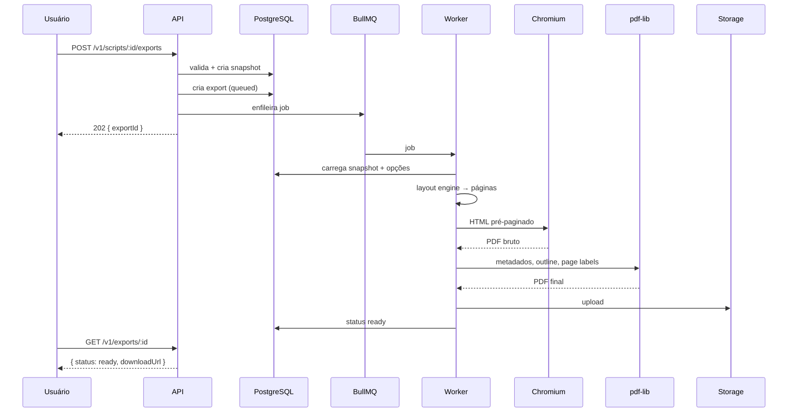

# Exportação em PDF

**Status:** proposta técnica para as fases 1 e 3  
**Tecnologias:** Playwright, Chromium fixado, `pdf-lib`, BullMQ, S3  
**Relaciona-se com:** [`normas-de-formatacao.md`](../02-roteiro/normas-de-formatacao.md), [`paginacao-e-quebras.md`](../02-roteiro/paginacao-e-quebras.md), [`arquitetura-geral.md`](arquitetura-geral.md), [`ADR-003`](adr/ADR-003-pdf-chromium.md)

---

## 1. Objetivo

Gerar um PDF que seja, ao mesmo tempo:

- fiel à prévia e ao editor paginado;
- compatível com leitores e impressoras;
- seguro para o usuário e para o servidor;
- rápido o suficiente para um roteiro de 120 páginas;
- observável e recuperável em caso de falha.

O PDF é o artefato de entrega do produto. Um PDF errado destrói a confiança mais rápido do que qualquer bug de interface.

## 2. Por que renderizar no servidor

### 2.1 Alternativas

| Abordagem | Vantagens | Problemas |
|---|---|---|
| Imprimir no navegador do usuário | Simples, sem infraestrutura | Fonte, margens e paginação variam por navegador; usuário precisa configurar; não é confiável |
| PDFKit ou biblioteca de PDF | Controle total, rápido | Reimplementa layout, quebra de linha, Unicode e posicionamento; difícil manter paridade |
| Chromium headless no servidor | Mesma composição da prévia, fonte incorporada, texto selecionável | Consome memória, exige sandbox, versão fixada |
| Serviço externo de PDF | Menos operação | Custo, privacidade, dependência, latência |

O FREEX escolhe **Chromium headless no servidor**, com uma pagina HTML pré-paginada pelo motor de layout. A decisão está no [ADR-003](adr/ADR-003-pdf-chromium.md).

### 2.2 A regra

O Chromium não decide quebras de página. Ele apenas desenha páginas já calculadas. Se o navegador decidisse, a paginação mudaria com a versão, o sistema operacional e a fonte. O motor de layout é a autoridade.

## 3. Pipeline



### 3.1 Etapas

1. **Validação.** O servidor valida o documento e as opções. Erros bloqueiam; avisos exigem confirmação.
2. **Snapshot.** O estado atual é congelado em `script_snapshots` com `document_json`, `state`, `layout_hash` e `profile_version`.
3. **Job.** Um registro `exports` é criado com status `queued` e um job é enfileirado.
4. **Layout.** O worker executa o motor de layout sobre o `document_json`.
5. **HTML.** O worker monta uma página HTML com uma `div` por página, coordenadas absolutas e CSS inline.
6. **PDF.** O Chromium imprime com tamanho fixo, margens zero e fonte carregada.
7. **Pós-processamento.** `pdf-lib` adiciona metadados, outline de cenas e page labels.
8. **Upload.** O PDF vai para o storage com hash SHA-256.
9. **Conclusão.** O status vira `ready` e a URL assinada é gerada sob demanda.
10. **Notificação.** O usuário vê o status no app; e-mail é opcional.

## 4. Fidelidade de layout

### 4.1 Fonte única

Prévia, editor paginado e PDF usam:

- o mesmo `document_json`;
- o mesmo `packages/layout`;
- o mesmo `profile_version`;
- a mesma tabela de fontes e medidas.

O PDF NÃO DEVE recalcular quebras com CSS. O HTML já contém as linhas posicionadas.

### 4.2 Estrutura do HTML

```html
<!doctype html>
<html lang="pt-BR">
  <head>
    <meta charset="utf-8">
    <style>
      @page { size: 8.5in 11in; margin: 0; }
      html, body { margin: 0; padding: 0; background: #fff; }
      .page {
        position: relative;
        width: 8.5in;
        height: 11in;
        overflow: hidden;
        page-break-after: always;
        background: #fff;
      }
      .line {
        position: absolute;
        white-space: pre;
        font-family: "Courier Prime", monospace;
        font-size: 12pt;
        line-height: 12pt;
        letter-spacing: 0;
        font-kerning: none;
      }
      .page-number {
        position: absolute;
        top: 0.5in;
        right: 1in;
        font-family: "Courier Prime", monospace;
        font-size: 12pt;
      }
    </style>
  </head>
  <body>
    <section class="page">
      <div class="line" style="left:1.5in;top:1in">INT. COZINHA - NOITE</div>
      <div class="page-number">2.</div>
    </section>
  </body>
</html>
```

Regras:

- Cada página é um `section.page` com tamanho fixo.
- Cada linha é um `div.line` com `left` e `top` absolutos.
- Não há fluxo de texto; não há `margin` ou `padding` que possa alterar a quebra.
- `white-space: pre` preserva espaços internos.
- `font-kerning: none` e `letter-spacing: 0` mantêm a grade.
- Nenhum recurso externo; CSS inline; sem JavaScript.
- Nenhuma imagem no MVP; se houver, `data:` URL e com `alt`.

### 4.3 Prévia no navegador

A prévia usa o mesmo HTML, em um `iframe` ou em um componente que renderiza as páginas. O CSS de tela pode adicionar sombra e zoom, mas o conteúdo é o mesmo. O modo de impressão remove sombra, zoom e qualquer borda. No celular, a prévia paginada usa esse mesmo HTML e é somente leitura; o modo linear de edição não participa da paginação.

### 4.4 Teste de paridade

- Comparar `layout_hash` da prévia e do PDF.
- Comparar número de páginas.
- Comparar a posição de cada linha.
- Comparar o texto extraído.
- Tolerância: 0,01 pol para posição; zero para número de páginas e quebras.

## 5. Fonte

### 5.1 Courier Prime

- Licença SIL Open Font License.
- Arquivos WOFF2 para tela e TTF/OTF para o Chromium.
- `@font-face` com `font-display: block`.
- Carregar antes de imprimir:

```js
await page.evaluate(async () => {
  await document.fonts.load('12pt "Courier Prime"');
  await document.fonts.ready;
});
```

- Verificar:

```js
const loaded = await page.evaluate(() =>
  document.fonts.check('12pt "Courier Prime"')
);
if (!loaded) throw new Error('FONT_NOT_LOADED');
```

### 5.2 Incorporação

- O Chromium incorpora a fonte no PDF.
- O PDF DEVE ser verificado com `pdffonts` ou equivalente.
- A fonte DEVE estar subsetada.
- Não usar fallback `monospace` silencioso.
- Se a fonte não carregar, o job falha com `EXPORT_FONT_ERROR`.

### 5.3 Fonte e versionamento

- O perfil padrão usa exclusivamente Courier Prime.
- Não há opção de troca de fonte. Uma mudança de fonte exige novo perfil, nova `profile_version` e novo ADR.
- A fonte é versionada; mudar a versão pode mudar métricas. Registrar no `renderer_version`.

## 6. Impressão no Chromium

### 6.1 Configuração

```js
const browser = await chromium.launch({
  headless: true,
  args: [
    '--font-render-hinting=none',
    '--disable-lcd-text',
    '--disable-dev-shm-usage',
    '--no-sandbox' // somente em container endurecido; ver 12.2
  ]
});

const context = await browser.newContext({
  javaScriptEnabled: false,
  viewport: { width: 816, height: 1056 },
  deviceScaleFactor: 1
});

const page = await context.newPage();
await page.setContent(html, { waitUntil: 'domcontentloaded' });
await page.evaluate(async () => {
  await document.fonts.load('12pt "Courier Prime"');
  await document.fonts.ready;
});

const pdf = await page.pdf({
  format: 'Letter',
  width: '8.5in',
  height: '11in',
  margin: { top: 0, right: 0, bottom: 0, left: 0 },
  printBackground: true,
  preferCSSPageSize: true,
  tagged: true // se suportado pela versão fixada
});
```

Observações:

- `javaScriptEnabled: false` reduz a superfície de ataque.
- `preferCSSPageSize: true` garante que o `@page` mande.
- `printBackground: true` preserva marca d'água e faixas de revisão.
- `tagged: true` é desejável para acessibilidade; se a versão fixada não suportar, o job segue sem tagging e o requisito fica documentado como pendente.
- Não usar `displayHeaderFooter`; o cabeçalho é nosso.
- Não usar `scale`; escala 1.

### 6.2 Versão fixada

- A imagem Docker do worker fixa a versão do Chromium e do Playwright.
- Atualizações passam por testes golden.
- A versão é registrada em `renderer_version`.
- PDFs antigos não são regerados com a versão nova.

## 7. Composição das páginas

### 7.1 Ordem

1. Página de título (opcional).
2. Lista de cenas (opcional).
3. Lista de personagens (opcional).
4. Roteiro.
5. Apêndice de comentários (opcional).

### 7.2 Numeração

- Página de título, listas e apêndice não são numerados.
- A primeira página do roteiro é a página 1, sem número impresso.
- A página 2 do roteiro é impressa como `2.`.
- O número físico do PDF não é o número lógico; usar page labels para o visualizador.

### 7.3 Cabeçalho de produção

- Cor e data da revisão à esquerda do número.
- Fonte 12 pt.
- Não desloca o corpo.

### 7.4 Marca d'água

- Texto em cinza claro, diagonal, centralizado.
- Não usar imagem.
- Não afetar a leitura.
- Não aparece na página de título.
- É parte do PDF; não é removível.

### 7.5 Comentários

- Não são impressos no corpo.
- Podem ser incluídos como apêndice, com autor, trecho e thread.
- O apêndice não altera a paginação do roteiro.
- O padrão é não incluir.

### 7.6 Outline e bookmarks

- `pdf-lib` cria um outline com os cabeçalhos de cena.
- Cada entrada aponta para a página correspondente.
- O título do bookmark é o texto do cabeçalho.
- Cenas duplicadas recebem numeração ou contexto.
- O outline é opcional, mas melhora a navegação.

## 8. Opções de exportação

| Opção | Tipo | Padrão | Impacto |
|---|---|---|---|
| `includeTitlePage` | boolean | true | Adiciona 1 página não numerada |
| `includeSceneList` | boolean | false | Adiciona front matter |
| `includeCharacterList` | boolean | false | Adiciona front matter |
| `includeComments` | boolean | false | Adiciona apêndice |
| `pageRange` | string | null | Exporta trecho; números originais |
| `pageSize` | `letter`/`a4` | `letter` | Muda a grade |
| `watermark` | string | null | Overlay |
| `includeSceneNumbers` | boolean | false | Produção |
| `includeRevisionColors` | boolean | false | Produção |
| `includeContinued` | boolean | false | Produção |
| `language` | `en-US`/`pt-BR` | do roteiro | Vocabulário da página de título |

As opções são validadas com Zod e registradas em `exports.options`. O hash das opções entra na chave de cache.

## 9. Fila e processamento

### 9.1 BullMQ

- Fila: `pdf-export`.
- Concorrência: 2 jobs por worker de 2 vCPU/4 GB (ajustar com medição).
- Timeout: 120 s.
- Tentativas: 3.
- Backoff: exponencial com jitter.
- Dead letter: fila `pdf-export-dead`.
- Prioridade: exportações interativas antes de lotes.

### 9.2 Estados

```text
queued → processing → ready
                    ↘ failed
queued → cancelled
ready → expired
```

- `queued`: job criado, aguardando worker.
- `processing`: worker pegou o job.
- `ready`: PDF disponível.
- `failed`: erro definitivo após retries.
- `expired`: PDF removido por retenção.
- `cancelled`: usuário cancelou antes de processar.

### 9.3 Idempotência

- `POST /exports` aceita `Idempotency-Key`.
- A chave é única por usuário e endpoint.
- Repetir a chamada devolve o mesmo `exportId`.
- O cache por hash evita trabalho duplicado.

### 9.4 Cache

```text
cacheKey = sha256(
  snapshot.layout_hash +
  hash(options) +
  renderer_version +
  profile_version
)
```

- Se existir PDF `ready` com a mesma chave, reutilizar.
- O cache é por snapshot, não por script. Uma nova edição gera novo snapshot e novo hash.
- PDFs de cache expiram em 7 dias.

## 10. Armazenamento e download

### 10.1 Storage

- Chave: `exports/{projectId}/{scriptId}/{exportId}.pdf`.
- Metadados: `Content-Type: application/pdf`, `Content-Disposition: attachment`.
- Hash SHA-256 no banco.
- Tamanho máximo: 50 MB.
- Criptografia no provedor.

### 10.2 URL assinada

- Gerada sob demanda.
- Expira em 24 h.
- Não expõe o caminho interno.
- `Cache-Control: private, no-store`.
- Download exige sessão ou token de link válido.
- O link pode ser revogado removendo o export.

### 10.3 Retenção

- PDFs ficam 7 dias.
- Metadados de exportação ficam 90 dias.
- Após 7 dias, status vira `expired` e o objeto é removido.
- O usuário pode exportar novamente a partir do mesmo snapshot enquanto ele existir.

## 11. Determinismo

### 11.1 O que é garantido

- Mesmo snapshot + mesmas opções + mesma versão de renderizador = mesmo layout.
- Mesmo número de páginas.
- Mesmos pontos de quebra.
- Mesmas posições de linha.
- Mesmo texto.

### 11.2 O que não é garantido

- Bytes idênticos do PDF. Chromium pode incluir datas, IDs e ordenação de objetos.
- Compatibilidade com versões futuras de Chromium.
- Renderização idêntica em sistemas operacionais diferentes; o worker fixa o ambiente.

### 11.3 Como garantir

- Versão de Chromium fixada.
- Fonte fixada.
- Locale e timezone fixos (`en-US`, `UTC`).
- Sem `Date.now()` no HTML.
- Sem IDs aleatórios.
- CSS inline e determinístico.
- Sem animações.
- Sem recursos externos.
- Testes golden em CI.

## 12. Segurança

### 12.1 Superfície

- O worker processa HTML gerado internamente, não HTML do usuário.
- O texto do roteiro é escapado antes de entrar no HTML.
- Não há JavaScript no documento.
- Não há requisições de rede.
- Não há fontes ou imagens externas.

### 12.2 Sandbox

- Container não-root.
- Seccomp/AppArmor.
- Filesystem read-only, exceto `/tmp`.
- Limite de CPU e memória.
- Sem acesso à rede.
- `--no-sandbox` só é aceitável em container com isolamento reforçado; caso contrário, usar o sandbox do Chromium.
- Limpeza de `/tmp` após cada job.
- Uma instância comprometida não deve alcançar o banco de produção; usar credenciais de leitura mínimas.

### 12.3 Dados

- O worker lê apenas o snapshot do job.
- Não grava conteúdo em logs.
- O PDF é armazenado em bucket privado.
- URLs assinadas são curtas.
- Nenhum dado de outro projeto é acessível por chave de storage.

### 12.4 Ameaças

| Ameaça | Mitigação |
|---|---|
| XSS no PDF | Texto escapado; sem HTML do usuário |
| SSRF | Sem rede; sem URLs externas |
| DoS por documento gigante | Limite de 300 páginas e 120 s |
| Vazamento por cache | Chave inclui projeto e snapshot; autorização no download |
| Fonte maliciosa | Apenas fontes do repositório |
| Chromium comprometido | Container isolado, versão fixada, scan de imagem |

## 13. Desempenho

| Métrica | Meta |
|---|---|
| 10 páginas | p95 < 3 s |
| 120 páginas | p95 < 15 s |
| 300 páginas | < 60 s |
| Memória por job de 120 páginas | < 1 GB |
| Tamanho do PDF de 120 páginas | < 5 MB |
| Throughput por worker | 4 jobs/min (ajustar) |

Otimizações:

- Reutilizar browser entre jobs, com contexto isolado.
- Fechar páginas e contextos sempre.
- Cache por hash.
- Evitar imagens.
- Minimizar HTML.
- Não usar `networkidle`.

## 14. Observabilidade

### 14.1 Métricas

- jobs por status;
- duração por faixa de páginas;
- memória do worker;
- tamanho do PDF;
- falhas por código;
- cache hit rate;
- backlog da fila;
- tempo de upload.

### 14.2 Logs

Eventos:

- `export.queued`;
- `export.started`;
- `export.succeeded`;
- `export.failed`;
- `export.cached`;
- `export.downloaded`.

Campos: `export_id`, `script_id`, `project_id`, `user_id`, `page_count`, `duration_ms`, `renderer_version`, `error_code`. Nunca o texto.

### 14.3 Alertas

- backlog > 50 jobs por 10 min;
- falha > 5% em 15 min;
- duração p95 > 30 s;
- memória > 80% do limite;
- dead letter > 0.

## 15. Testes

### 15.1 Golden PDFs

- Fixtures em `packages/test/fixtures`.
- PDFs de referência versionados.
- Comparação de:
  - número de páginas;
  - texto extraído;
  - posição de linhas;
  - fontes incorporadas;
  - metadados.
- Diferença visual com tolerância para antialiasing.

### 15.2 Casos

| Caso | Verificação |
|---|---|
| 10 páginas, todos os elementos | Layout, texto, página |
| 120 páginas | Desempenho, memória |
| Diálogo quebrado | `(MORE)` / `(CONT'D)` |
| Diálogo duplo | Colunas alinhadas |
| Página de título | Sem número, contato correto |
| Acentos e cedilha | Texto correto, fonte incorporada |
| Cabeçalho longo | Quebra e aviso |
| A4 | Grade 57 × 58 |
| Intervalo de páginas | Números originais |
| Marca d'água | Visível, não intrusiva |
| Cores de revisão | Cabeçalho e faixa |
| Outline | Cenas navegáveis |

### 15.3 Ferramentas

- `pdftotext` para texto.
- `pdffonts` para fontes.
- `pdfinfo` para páginas e metadados.
- `pixelmatch` ou ImageMagick para diff visual.
- Playwright para gerar e comparar.

## 16. Critérios de aceite

- PDF e prévia têm o mesmo número de páginas.
- O PDF tem a fonte Courier Prime incorporada.
- O texto é selecionável e copiável.
- A página de título não é numerada.
- A numeração começa em 2 na segunda página do roteiro.
- `(MORE)` e `(CONT'D)` aparecem corretamente.
- Diálogo duplo não se sobrepõe.
- Acentos e cedilha renderizam corretamente.
- 120 páginas exportam em menos de 15 s no p95.
- Um job falho não deixa PDF parcial disponível.
- Um PDF de outro projeto não é acessível por URL.
- O worker não faz requisições de rede.
- O cache não serve PDF de snapshot diferente.
- O histórico registra quem exportou, quando e qual versão.
