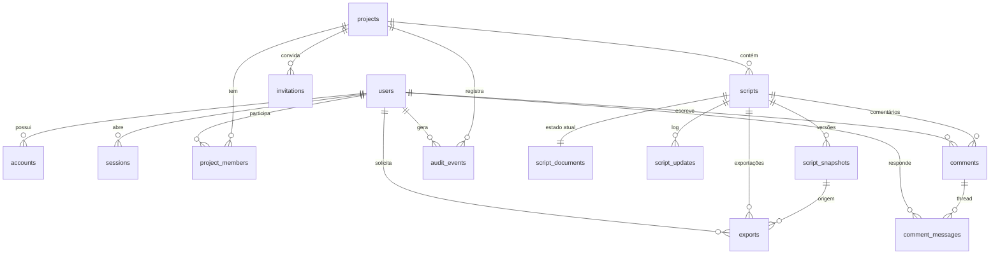

# Modelo de dados

**Status:** proposta técnica para a fase 1  
**Banco:** PostgreSQL 16  
**ORM:** Drizzle  
**Relaciona-se com:** [`arquitetura-geral.md`](arquitetura-geral.md), [`api.md`](api.md), [`colaboracao-tempo-real.md`](colaboracao-tempo-real.md)

---

## 1. Objetivo

Definir as entidades, relações, invariantes e políticas de retenção que sustentam contas, projetos, roteiros, colaboração, comentários, versões e exportações.

O modelo precisa suportar:

- isolamento entre projetos;
- edição colaborativa com histórico;
- snapshots imutáveis para exportação;
- comentários ancorados no texto;
- auditoria;
- evolução de schema sem perda de dados.

## 2. Diagrama entidade-relacionamento



## 3. Convenções

- IDs: UUID v7 para entidades ordenáveis por tempo; `bigserial` para logs.
- Datas: `timestamptz`, sempre UTC.
- Texto: `text` com `CHECK` de tamanho quando necessário.
- E-mail: `citext` para comparação case-insensitive.
- JSON: `jsonb` para metadados e opções.
- Binário: `bytea` para estado Yjs e atualizações.
- Soft delete: `deleted_at` em entidades de usuário e projeto; snapshots e auditoria não são apagados logicamente.
- Nomes de tabelas e colunas em inglês, `snake_case`.
- Toda tabela tem `created_at`; as mutáveis têm `updated_at`.

## 4. Tabelas

### 4.1 `users`

| Coluna | Tipo | Restrições |
|---|---|---|
| `id` | uuid | PK |
| `email` | citext | UNIQUE, NOT NULL |
| `name` | text | NOT NULL, 1–120 |
| `avatar_url` | text | NULL |
| `password_hash` | text | NULL (contas OAuth) |
| `locale` | text | NOT NULL, default `pt-BR` |
| `timezone` | text | NOT NULL, default `America/Sao_Paulo` |
| `email_verified_at` | timestamptz | NULL |
| `created_at` | timestamptz | NOT NULL |
| `updated_at` | timestamptz | NOT NULL |
| `deleted_at` | timestamptz | NULL |

Índices: `unique(email)`, `index(deleted_at)`.

Regras: e-mail é imutável após verificação, salvo fluxo de troca com confirmação. Exclusão anonimiza e-mail e nome após 30 dias.

### 4.2 `accounts`

Contas OAuth vinculadas.

| Coluna | Tipo | Restrições |
|---|---|---|
| `id` | uuid | PK |
| `user_id` | uuid | FK users, ON DELETE CASCADE |
| `provider` | text | NOT NULL (`google`, `apple`) |
| `provider_account_id` | text | NOT NULL |
| `access_token_encrypted` | bytea | NULL |
| `refresh_token_encrypted` | bytea | NULL |
| `expires_at` | timestamptz | NULL |
| `created_at` | timestamptz | NOT NULL |

Índices: `unique(provider, provider_account_id)`, `index(user_id)`.

Tokens são criptografados com chave gerenciada; nunca aparecem em logs.

### 4.3 `sessions`

| Coluna | Tipo | Restrições |
|---|---|---|
| `id` | uuid | PK |
| `user_id` | uuid | FK users, ON DELETE CASCADE |
| `token_hash` | text | UNIQUE, NOT NULL |
| `expires_at` | timestamptz | NOT NULL |
| `created_at` | timestamptz | NOT NULL |
| `last_seen_at` | timestamptz | NOT NULL |
| `ip` | inet | NULL |
| `user_agent` | text | NULL |

Índices: `unique(token_hash)`, `index(user_id, expires_at)`.

### 4.4 `verification_tokens`

| Coluna | Tipo | Restrições |
|---|---|---|
| `id` | uuid | PK |
| `user_id` | uuid | FK users, ON DELETE CASCADE |
| `type` | text | `email_verify`, `password_reset`, `mfa_recovery` |
| `token_hash` | text | UNIQUE, NOT NULL |
| `expires_at` | timestamptz | NOT NULL |
| `used_at` | timestamptz | NULL |
| `created_at` | timestamptz | NOT NULL |

O Better Auth é integrado por uma camada Drizzle própria em `packages/auth`, que mapeia os modelos `user`, `account`, `session` e `verification` para as tabelas acima. O hash de senha, o hash dos tokens de sessão e verificação e a localização dos campos ficam nessa camada; as regras desta seção continuam valendo.

### 4.5 `projects`

| Coluna | Tipo | Restrições |
|---|---|---|
| `id` | uuid | PK |
| `owner_id` | uuid | FK users, NOT NULL |
| `title` | text | NOT NULL, 1–200 |
| `description` | text | NULL |
| `language` | text | NOT NULL, default `pt-BR` |
| `format` | text | `feature`, `short`, `tv_pilot`, `tv_episode` |
| `default_page_size` | text | `letter` (default), `a4` |
| `archived_at` | timestamptz | NULL |
| `deleted_at` | timestamptz | NULL |
| `created_at` | timestamptz | NOT NULL |
| `updated_at` | timestamptz | NOT NULL |

Índices: `index(owner_id)`, `index(updated_at desc)`, `index(deleted_at)`.

### 4.6 `project_members`

| Coluna | Tipo | Restrições |
|---|---|---|
| `project_id` | uuid | FK projects, ON DELETE CASCADE |
| `user_id` | uuid | FK users, ON DELETE CASCADE |
| `role` | text | `owner`, `editor`, `commenter`, `viewer` |
| `invited_by` | uuid | FK users, NULL |
| `joined_at` | timestamptz | NOT NULL |
| `created_at` | timestamptz | NOT NULL |

PK composta: `(project_id, user_id)`.
Índices: `index(user_id)`, `index(project_id, role)`.

Invariantes:

- Deve existir exatamente um `owner` ativo por projeto.
- `owner_id` em `projects` e o membro com papel `owner` devem coincidir.
- A troca de propriedade é transacional: promove o novo owner, rebaixa o antigo, atualiza `projects.owner_id`.

Para garantir "exatamente um owner", usar índice único parcial:

```sql
CREATE UNIQUE INDEX one_owner_per_project
ON project_members (project_id)
WHERE role = 'owner';
```

### 4.7 `invitations`

| Coluna | Tipo | Restrições |
|---|---|---|
| `id` | uuid | PK |
| `project_id` | uuid | FK projects, ON DELETE CASCADE |
| `email` | citext | NOT NULL |
| `role` | text | `editor`, `commenter`, `viewer` |
| `token_hash` | text | UNIQUE, NOT NULL |
| `invited_by` | uuid | FK users, NOT NULL |
| `expires_at` | timestamptz | NOT NULL |
| `accepted_at` | timestamptz | NULL |
| `created_at` | timestamptz | NOT NULL |

Índices: `index(project_id, email)`, `index(expires_at)`.

Regras: convite expirado não pode ser aceito; reenvio gera novo token e invalida o anterior.

### 4.8 `scripts`

| Coluna | Tipo | Restrições |
|---|---|---|
| `id` | uuid | PK |
| `project_id` | uuid | FK projects, ON DELETE CASCADE |
| `title` | text | NOT NULL, 1–200 |
| `format` | text | `feature`, `short`, `tv_pilot`, `tv_episode` |
| `language` | text | `en-US`, `pt-BR` |
| `page_size` | text | `letter`, `a4` |
| `font` | text | `courier_prime` |
| `status` | text | `draft`, `review`, `final`, `archived` |
| `created_at` | timestamptz | NOT NULL |
| `updated_at` | timestamptz | NOT NULL |
| `deleted_at` | timestamptz | NULL |

Índices: `index(project_id, updated_at desc)`, `index(project_id, deleted_at)`.

### 4.9 `script_documents`

Estado atual do documento colaborativo.

| Coluna | Tipo | Restrições |
|---|---|---|
| `script_id` | uuid | PK, FK scripts, ON DELETE CASCADE |
| `state` | bytea | NOT NULL |
| `schema_version` | int | NOT NULL |
| `last_seq` | bigint | NOT NULL, default 0 |
| `layout_hash` | text | NULL |
| `updated_at` | timestamptz | NOT NULL |

`state` é o estado Yjs codificado (`Y.encodeStateAsUpdate`). É a fonte de verdade para abrir uma sala.

### 4.10 `script_updates`

Log append-only de atualizações Yjs, para recuperação e auditoria técnica.

| Coluna | Tipo | Restrições |
|---|---|---|
| `id` | bigserial | PK |
| `script_id` | uuid | FK scripts, ON DELETE CASCADE |
| `seq` | bigint | NOT NULL |
| `update` | bytea | NOT NULL |
| `actor_id` | uuid | FK users, NULL |
| `created_at` | timestamptz | NOT NULL |

Índices: `unique(script_id, seq)`, `index(script_id, created_at desc)`.

Particionamento por mês quando o volume justificar. Retenção curta após snapshot.

### 4.11 `script_snapshots`

Versões imutáveis.

| Coluna | Tipo | Restrições |
|---|---|---|
| `id` | uuid | PK |
| `script_id` | uuid | FK scripts, ON DELETE CASCADE |
| `version_number` | int | NOT NULL |
| `kind` | text | `auto`, `manual`, `export`, `restore` |
| `label` | text | NULL |
| `description` | text | NULL |
| `state` | bytea | NOT NULL |
| `document_json` | jsonb | NOT NULL |
| `layout_hash` | text | NOT NULL |
| `profile_version` | text | NOT NULL |
| `created_by` | uuid | FK users, NULL (auto) |
| `created_at` | timestamptz | NOT NULL |

Índices: `unique(script_id, version_number)`, `index(script_id, created_at desc)`, `index(script_id, kind)`.

Regras:

- Snapshots são imutáveis. Não há `UPDATE` nem `DELETE` exceto pela política de retenção.
- `document_json` é o documento canônico, independente do Yjs, usado para exportação e diff.
- `state` permite restaurar a sala sem reconstruir o histórico.
- `version_number` é sequencial por roteiro, nunca reutilizado.

### 4.12 `comments`

| Coluna | Tipo | Restrições |
|---|---|---|
| `id` | uuid | PK |
| `script_id` | uuid | FK scripts, ON DELETE CASCADE |
| `author_id` | uuid | FK users, NOT NULL |
| `anchor_start` | bytea | NOT NULL |
| `anchor_end` | bytea | NOT NULL |
| `selected_text` | text | NOT NULL |
| `status` | text | `open`, `resolved` |
| `orphaned_at` | timestamptz | NULL |
| `resolved_at` | timestamptz | NULL |
| `resolved_by` | uuid | FK users, NULL |
| `created_at` | timestamptz | NOT NULL |
| `updated_at` | timestamptz | NOT NULL |

Índices: `index(script_id, status, created_at)`, `index(author_id)`.

`anchor_start` e `anchor_end` são posições relativas do Yjs codificadas. `selected_text` é um snapshot para exibição quando o anchor não resolve. Se o anchor não resolver, `orphaned_at` é preenchido e o comentário continua visível como "desanexado".

### 4.13 `comment_messages`

| Coluna | Tipo | Restrições |
|---|---|---|
| `id` | uuid | PK |
| `comment_id` | uuid | FK comments, ON DELETE CASCADE |
| `author_id` | uuid | FK users, NOT NULL |
| `body` | text | NOT NULL, 1–5000 |
| `created_at` | timestamptz | NOT NULL |
| `edited_at` | timestamptz | NULL |
| `deleted_at` | timestamptz | NULL |

Índices: `index(comment_id, created_at)`.

O primeiro comentário da thread é uma mensagem; a tabela `comments` guarda o anchor e o status. A UI pode renderizar a thread como `comments` + `comment_messages`.

### 4.14 `exports`

| Coluna | Tipo | Restrições |
|---|---|---|
| `id` | uuid | PK |
| `script_id` | uuid | FK scripts, ON DELETE CASCADE |
| `snapshot_id` | uuid | FK script_snapshots, NOT NULL |
| `requested_by` | uuid | FK users, NOT NULL |
| `status` | text | `queued`, `processing`, `ready`, `failed`, `expired` |
| `options` | jsonb | NOT NULL |
| `storage_key` | text | NULL |
| `sha256` | text | NULL |
| `page_count` | int | NULL |
| `file_size` | bigint | NULL |
| `error_code` | text | NULL |
| `error_message` | text | NULL |
| `renderer_version` | text | NOT NULL |
| `profile_version` | text | NOT NULL |
| `created_at` | timestamptz | NOT NULL |
| `started_at` | timestamptz | NULL |
| `completed_at` | timestamptz | NULL |
| `expires_at` | timestamptz | NULL |

Índices: `index(script_id, created_at desc)`, `index(status)`, `index(expires_at)`.

### 4.15 `audit_events`

| Coluna | Tipo | Restrições |
|---|---|---|
| `id` | bigserial | PK |
| `project_id` | uuid | FK projects, NULL para eventos de conta |
| `actor_id` | uuid | FK users, NULL para sistema |
| `event_type` | text | NOT NULL |
| `target_type` | text | NULL |
| `target_id` | uuid | NULL |
| `metadata` | jsonb | NOT NULL, default `{}` |
| `ip` | inet | NULL |
| `user_agent` | text | NULL |
| `created_at` | timestamptz | NOT NULL |

Índices: `index(project_id, created_at desc)`, `index(actor_id, created_at desc)`, `index(event_type)`.

Eventos: `auth.login`, `project.created`, `member.invited`, `member.role_changed`, `script.exported`, `snapshot.restored`, `comment.resolved`, `account.deleted`.

Nunca guardar o texto do roteiro em `metadata`.

### 4.16 `idempotency_keys`

| Coluna | Tipo | Restrições |
|---|---|---|
| `key` | text | NOT NULL |
| `user_id` | uuid | FK users, ON DELETE CASCADE |
| `endpoint` | text | NOT NULL |
| `request_hash` | text | NOT NULL |
| `response_status` | int | NOT NULL |
| `response_body` | jsonb | NOT NULL |
| `created_at` | timestamptz | NOT NULL |
| `expires_at` | timestamptz | NOT NULL |

PK composta: `(key, user_id)`.
Índice: `index(expires_at)`.

Usado em `POST /exports`, `POST /invitations` e outras operações não idempotentes.

## 5. Documento canônico

### 5.1 Estrutura ProseMirror

O documento é uma árvore. Blocos de fala são agrupados para garantir que personagem, parêntese e diálogo não se separem.

```json
{
  "schemaVersion": 1,
  "type": "doc",
  "content": [
    {
      "type": "scene_heading",
      "attrs": { "sceneNumber": null },
      "content": [{ "type": "text", "text": "INT. COZINHA - NOITE" }]
    },
    {
      "type": "action",
      "content": [{ "type": "text", "text": "Ana abre a geladeira." }]
    },
    {
      "type": "speech",
      "content": [
        {
          "type": "character",
          "content": [{ "type": "text", "text": "ANA" }]
        },
        {
          "type": "dialogue",
          "content": [{ "type": "text", "text": "Você comeu?" }]
        }
      ]
    },
    {
      "type": "transition",
      "content": [{ "type": "text", "text": "CUT TO:" }]
    }
  ]
}
```

### 5.2 Tipos de nó

| Nó | Filhos | Atributos |
|---|---|---|
| `doc` | blocos | `schemaVersion` |
| `scene_heading` | texto | `sceneNumber`, `revisionColor` |
| `action` | texto | — |
| `speech` | `character`, `parenthetical?`, `dialogue+` | `dualGroupId?` |
| `dual_dialogue` | `speech`, `speech` | — |
| `character` | texto | `extension` |
| `parenthetical` | texto | — |
| `dialogue` | texto | — |
| `transition` | texto | — |
| `shot` | texto | — |

### 5.3 Invariantes do documento

- `speech` tem exatamente um `character` e pelo menos um `dialogue`.
- `parenthetical` só aparece entre `character` e `dialogue`, ou entre linhas de `dialogue`.
- `dual_dialogue` tem exatamente duas `speech`.
- `scene_heading` é o primeiro nó de uma cena, mas o documento pode começar com `FADE IN:` como `transition`.
- Não há `dialogue` no nível do `doc`; sempre dentro de `speech`.
- Marcas inline não alteram a largura.
- Texto não contém `\n`; quebras são nós.

### 5.4 Validação

- Schema ProseMirror no cliente e no servidor.
- Zod para o JSON canônico no limite da API.
- Validador de formatação separado, com erros e avisos.
- Migração de schema versionada; documento antigo é convertido ao abrir.

## 6. Índices e consultas críticas

| Consulta | Índice |
|---|---|
| Projetos do usuário | `project_members(user_id)` + `projects(updated_at desc)` |
| Membros de um projeto | `project_members(project_id)` |
| Roteiros de um projeto | `scripts(project_id, updated_at desc)` |
| Snapshot mais recente | `script_snapshots(script_id, version_number desc)` |
| Comentários abertos | `comments(script_id, status, created_at)` |
| Exportações recentes | `exports(script_id, created_at desc)` |
| Job por status | `exports(status, created_at)` |
| Auditoria do projeto | `audit_events(project_id, created_at desc)` |

Consultas de lista usam paginação por cursor (`created_at`, `id`), nunca `OFFSET` em tabelas grandes.

## 7. Isolamento entre projetos

Toda consulta que retorna dados de projeto deve incluir `project_id` e verificar vínculo do usuário. Regras:

- Nunca aceitar `project_id` do corpo sem verificar a sessão.
- Nunca buscar um `script_id` sem junção com `project_members`.
- Respostas 404 para recurso de outro projeto, não 403, para não revelar existência.
- IDs são UUID; não são segredo, mas não substituem autorização.
- Testes de isolamento cobrem todos os endpoints.

Defesa em profundidade opcional: Row-Level Security no PostgreSQL, com `SET LOCAL app.user_id` por transação. Se adotada, documentar e testar; não substitui a verificação na aplicação.

## 8. Migrações

### 8.1 Estratégia

- Migrações versionadas no repositório, geradas pelo Drizzle.
- Forward-only; rollback é feito por migração compensatória.
- Expand/contract para mudanças incompatíveis:
  1. adicionar coluna nullable;
  2. backfill em job;
  3. tornar obrigatória;
  4. remover coluna antiga em release posterior.
- Migrações rodam antes do deploy, em job separado.
- Backup antes de migração destrutiva.

### 8.2 Versionamento de documento

- `schemaVersion` no JSON e em `script_documents`.
- Migração de documento é código, não SQL.
- Documento antigo é convertido na leitura e regravado no próximo snapshot.
- Nunca alterar um snapshot histórico; converter na exportação, se necessário.

### 8.3 Dados de teste

- Fixtures versionadas em `packages/test/fixtures`.
- Seed local com usuários, projetos e roteiros de exemplo.
- Nunca usar dados reais em staging ou preview.

## 9. Retenção e exclusão

| Dado | Retenção | Exclusão |
|---|---|---|
| Conta | Enquanto ativa | 30 dias de carência; depois anonimização |
| Projeto | Enquanto ativo | 30 dias em lixeira; depois exclusão |
| Roteiro | Enquanto o projeto existir | Soft delete; 30 dias |
| `script_updates` | 30 dias após snapshot | Job de compactação |
| Snapshots automáticos | 90 dias | Job de retenção |
| Snapshots manuais | Vida do projeto | Exclusão do projeto |
| Exportações | 7 dias | Job de limpeza |
| Comentários | Vida do roteiro | Exclusão do roteiro |
| Auditoria | 2 anos | Job de retenção |
| Sessões | 30 dias | Expiração |
| Idempotência | 24 h | Expiração |

A exclusão de conta não apaga automaticamente projetos compartilhados; o usuário é removido e o projeto fica com outro owner. Se não houver outro, o projeto é arquivado e entra em processo de transferência.

## 10. Backup e recuperação

- Backup contínuo (PITR) com janela de 7 dias.
- Backup diário completo com retenção de 30 dias.
- Teste de restauração trimestral.
- RPO alvo: 5 min. RTO alvo: 1 h.
- Snapshots e exports no storage têm versionamento e ciclo de vida.
- Plano de recuperação documentado em [`../06-operacoes/deploy-e-observabilidade.md`](../06-operacoes/deploy-e-observabilidade.md).

## 11. Auditoria

Eventos mínimos:

- login, logout, falha de login;
- criação, arquivamento e exclusão de projeto;
- convite, aceite, mudança de papel e remoção de membro;
- criação, restauração e exclusão de roteiro;
- restauração de versão;
- criação e conclusão de exportação;
- exclusão de conta.

A auditoria não guarda texto de roteiro, senhas, tokens ou conteúdo de comentário. Guarda IDs, ator, tipo, resultado e metadados não sensíveis.

## 12. Critérios de aceite

- Um projeto não pode existir sem owner.
- Um usuário não acessa projeto do qual não é membro.
- Um snapshot é imutável.
- Uma exportação sempre referencia um snapshot.
- Comentários sobrevivem a edições e ficam órfãos de forma explícita.
- A exclusão de conta não deixa dados pessoais órfãos.
- Consultas de lista usam índice e paginação por cursor.
- Migrações passam em banco vazio e em banco com dados de fixture.
- O modelo suporta 300 páginas por roteiro e 50 editores simultâneos.
