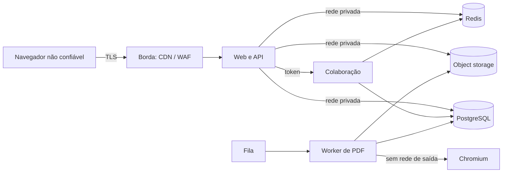

# Segurança e privacidade

**Status:** proposta para revisão antes do beta
**Relaciona-se com:** [`../01-requisitos/srs.md`](../01-requisitos/srs.md), [`arquitetura-geral.md`](arquitetura-geral.md), [`api.md`](api.md), [`colaboracao-tempo-real.md`](colaboracao-tempo-real.md), [`exportacao-pdf.md`](exportacao-pdf.md)

---

## 1. Objetivo

Definir como o FREEX protege contas, projetos, roteiros, comentários, versões e PDFs, e como trata dados pessoais. O roteiro de um usuário é propriedade intelectual não publicada. Um vazamento não é só um incidente de segurança; é um dano comercial e criativo.

Este documento cobre:

- modelo de ameaças e superfícies de ataque;
- autenticação, sessão e autorização;
- isolamento entre projetos e entre organizações;
- proteção de dados em trânsito, em repouso e em uso;
- privacidade e direitos do titular;
- segurança da colaboração em tempo real e da exportação de PDF;
- auditoria, resposta a incidentes e continuidade.

Não substitui revisão jurídica. As obrigações de LGPD e GDPR dependem de contrato, região e natureza do tratamento, e devem ser validadas antes do lançamento público.

## 2. Princípios

1. **Falhar fechado.** Se uma verificação de autorização não puder ser concluída, o acesso é negado.
2. **Menor privilégio.** Cada usuário, serviço e job recebe apenas o acesso necessário.
3. **Negar por padrão.** Projeto, roteiro, comentário e exportação não são públicos sem uma concessão explícita.
4. **O servidor decide.** A interface esconde ações; a API e o WebSocket as impedem.
5. **Defesa em profundidade.** Borda, aplicação, banco e storage têm controles próprios.
6. **Conteúdo de roteiro não é log.** Texto, comentários e trechos de PDF não entram em logs, traces ou métricas.
7. **Segredo não mora no repositório.** Chaves, tokens e senhas vêm de secret manager.
8. **Toda decisão sensível é auditável.** Quem, o quê, quando, de onde e com qual resultado.

## 3. Modelo de ameaças

### 3.1 Ativos

| Ativo | Sensibilidade | Impacto de exposição |
|---|---|---|
| Texto do roteiro | Confidencial | Vazamento de propriedade intelectual antes do lançamento |
| Comentários e versões | Confidencial | Exposição de crítica, bastidores e decisões criativas |
| Dados de conta | Pessoal | Identificação, phishing, acesso indevido |
| Permissões e convites | Interno | Escalada de privilégio |
| PDFs exportados | Confidencial | Distribuição não autorizada |
| Tokens e chaves | Crítico | Comprometimento total de conta ou serviço |
| Logs e métricas | Interno | Correlação de comportamento e vazamento indireto |

### 3.2 Atores e motivações

- **Usuário legítimo curioso.** Tenta acessar projeto de outra pessoa alterando um ID.
- **Membro desligado.** Mantém sessão ou token após perder o vínculo.
- **Atacante externo.** Credential stuffing, phishing, exploração de dependência.
- **Insider.** Funcionário ou prestador com acesso a banco, storage ou suporte.
- **Automação maliciosa.** Scraping, abuso de exportação, flood de WebSocket.
- **Terceiro subprocessador.** Falha ou incidente em e-mail, storage ou observabilidade.

### 3.3 Fronteiras de confiança

Tudo à esquerda da borda é hostil. Tudo que entra no servidor é validado. O worker de PDF não confia no HTML que renderiza, mesmo sendo gerado por nós.

### 3.4 Ameaças principais e controles

| Ameaça | Vetor | Controle |
|---|---|---|
| Acesso a projeto alheio (IDOR) | Troca de UUID em URL ou payload | Verificação de vínculo em toda consulta; nenhuma consulta por ID sem `project_id` e `member_id` |
| Escalada de privilégio | Alteração de `role` no cliente | Papel lido do banco no servidor; token não é autoridade |
| Sequestro de sessão | XSS, cookie roubado | Cookie `HttpOnly`, `Secure`, CSP estrita, rotação de sessão |
| CSRF | Formulário em site externo | `SameSite=Lax`, verificação de `Origin`, token CSRF em ações sensíveis |
| Credential stuffing | Lista de senhas vazadas | Argon2id, rate limit, bloqueio progressivo, MFA opcional |
| Injeção | Texto malicioso em comentário ou título | Validação Zod, consultas parametrizadas, escape na renderização |
| XSS armazenado | Comentário com HTML | Renderização como texto; sanitização quando houver rich text |
| SSRF | URL em campo de perfil ou importação | Allowlist de destinos, sem requisição a rede interna |
| Abuso de exportação | Muitos jobs em sequência | Rate limit, fila, limite por conta, cache |
| Vazamento por PDF | URL previsível ou pública | URL assinada, expiração, verificação de membro |
| Vazamento por log | Texto em mensagem de erro | Redaction, revisão de logger, testes de log |
| Dependência comprometida | Pacote npm malicioso | Lockfile, scan, revisão de atualização, procedência |
| Ataque ao WebSocket | Payload gigante, conexão infinita | Limite de tamanho, taxa, conexões, timeout |

## 4. Autenticação

As regras desta seção são requisitos do produto e valem independentemente da biblioteca. A implementação prevista usa Better Auth com schema próprio; a camada de auth deve garantir os controles abaixo.

### 4.1 Credenciais

- Senha com no mínimo 12 caracteres, sem exigência de composição artificial.
- Hash com Argon2id, parâmetros calibrados para o hardware de produção e revisados a cada ano.
- Comparação em tempo constante.
- Nunca registrar senha, hash ou token em log.
- Verificação de senhas vazadas contra base de referência quando disponível, sem enviar a senha em claro.

### 4.2 Sessão

- Cookie `freex_session`, `HttpOnly`, `Secure`, `SameSite=Lax`.
- Token opaco, hash armazenado no servidor.
- Expiração deslizante de 30 dias, absoluta de 90 dias.
- Rotação do identificador de sessão no login e na elevação de privilégio.
- Logout invalida a sessão no servidor, não apenas remove o cookie.
- Revogação individual por dispositivo.
- Alteração de senha revoga todas as outras sessões.

### 4.3 OAuth

- Google no MVP, com `state` e PKCE.
- Conta existente vinculada apenas por e-mail verificado pelo provedor.
- E-mail não verificado exige confirmação antes de vincular.
- Nenhum token de provedor é exposto ao cliente.

### 4.4 Recuperação e verificação

- Token de uso único, aleatório, com hash no banco.
- Expiração de 1 h para recuperação e 24 h para verificação.
- Resposta uniforme para e-mail existente e inexistente.
- Reenvio limitado por conta e por IP.
- Link de recuperação não revela o e-mail em URL pública.

### 4.5 MFA

- TOTP opcional no MVP, obrigatório para contas administrativas.
- Códigos de recuperação de uso único, armazenados com hash.
- Ativação exige confirmação com código válido antes de valer.

### 4.6 Proteção contra abuso

- Rate limit por IP, conta e dispositivo.
- Bloqueio progressivo após falhas repetidas, com backoff.
- CAPTCHA apenas quando o risco justificar, nunca como primeira barreira.
- Alertas para picos de falha de login e criação de conta.

## 5. Autorização

### 5.1 Papéis

Os papéis são `owner`, `editor`, `commenter` e `viewer`, com a matriz da [SRS](../01-requisitos/srs.md). Regras adicionais:

- todo projeto tem exatamente um `owner` ativo;
- `owner` não pode ser removido sem transferência;
- remoção de membro encerra sessões de colaboração e invalida tokens emitidos;
- convite expirado não é reutilizado;
- link de leitura, quando existir, é um token com escopo mínimo e expiração.

### 5.2 Pontos de aplicação

| Ponto | O que verifica |
|---|---|
| API REST | Sessão, vínculo com projeto, papel e escopo do recurso |
| WebSocket | Token, assinatura, expiração, `scriptId`, `projectId`, papel atual no banco |
| Worker de PDF | Se o snapshot pertence ao projeto e se o solicitante ainda tem acesso |
| Download | Se o usuário é membro e se a URL assinada não expirou |
| Comentários | Se o autor é membro e se o comentário pertence ao roteiro |
| Administração | MFA, papel de plataforma, consentimento e auditoria |

### 5.3 Regras de consulta

- Nenhuma consulta busca projeto, roteiro, snapshot ou exportação apenas por ID.
- O `project_id` faz parte da cláusula de autorização, não só do filtro.
- Consultas de lista sempre partem dos projetos do usuário.
- Um recurso inexistente e um recurso sem permissão retornam o mesmo erro para o usuário sem vínculo.
- Testes de isolamento criam dois tenants e tentam acesso cruzado em todos os endpoints.

### 5.3.1 Links de edição sem conta

Enquanto não há contas (FR-COL-016), o único controle de acesso a um roteiro compartilhado é a posse do link. O risco é aceito por decisão de produto e controlado assim:

| Risco | Controle |
|---|---|
| Adivinhar o link | Token de 256 bits (`crypto.randomBytes(32)`, 43 caracteres); a sala chama-se SHA-256 do token e o servidor só guarda esse hash |
| Vazamento do link por log ou `Referer` | O token vai no fragmento (`/s#token`), que o navegador não envia a nenhum servidor; a página usa `referrer: no-referrer` e `noindex`; o token não entra em log nem em URL de WebSocket |
| Qualquer pessoa com o link edita | É o efeito pretendido. O link é apresentado como uma senha; **não há revogação nem validade** (decisão aberta em `docs/README.md`) |
| Abuso na criação | Limite de 10 links por minuto por endereço; corpo de até 3 MB, validado com Zod |
| Abuso no WebSocket | Mensagem de até 1 MB, 100 mensagens/s por conexão, 50 conexões por sala, 60 por endereço, ping a cada 30 s, verificação de `Origin` |
| Nome falso ou ofensivo | O nome não é autenticado. É limpo no servidor e no cliente (normalização Unicode, sem controle, sem bidi, 30 caracteres) e mostrado sempre como texto, nunca como HTML |
| Cor da presença como vetor de CSS | Só `#rrggbb` passa; qualquer outro valor vira cinza |

O nome é dado pessoal informado livremente. Ele fica no navegador (`localStorage`), na presença (efêmera) e no mapa "quem editou" dentro do próprio documento, sem prazo de retenção definido.

### 5.4 Falha fechada

Se o serviço de permissões estiver indisponível:

- a API nega a operação;
- o WebSocket recusa novas conexões;
- sessões existentes entram em modo somente leitura;
- nenhuma escrita é aceita com base em cache expirado.

## 6. Tokens e chaves

| Token | Formato | TTL | Uso |
|---|---|---|---|
| Sessão | Opaco, hash no banco | 30 dias deslizante | Cookie |
| Colaboração | JWT assinado | 5 min | Handshake WebSocket |
| Recuperação | Opaco, hash no banco | 1 h | Link de e-mail |
| Verificação | Opaco, hash no banco | 24 h | Link de e-mail |
| Convite | Opaco, hash no banco | 7 dias | Link de e-mail |
| Download | URL assinada | 24 h | Storage |

Regras:

- chaves de assinatura em secret manager, com rotação e `kid`;
- JWT de colaboração tem `aud`, `iss`, `jti`, `exp` curto e não é aceito em REST;
- token de colaboração é de uso único para abrir a conexão; renovação ocorre antes de expirar;
- URLs assinadas não aparecem em log nem em histórico de navegador compartilhado;
- revogação de membro invalida tokens por versão de sessão ou denylist.

## 7. Dados e criptografia

### 7.1 Em trânsito

- TLS 1.3; TLS 1.2 apenas se o cliente não suportar, com cifras fortes.
- HSTS com `includeSubDomains` e `preload` quando o domínio estiver estável.
- Comunicação interna entre serviços em rede privada, com TLS quando atravessar host.
- Nenhum acesso direto do navegador ao banco, Redis ou storage.

### 7.2 Em repouso

- Banco, backups, objetos e volumes com criptografia AES-256.
- Chaves gerenciadas pelo provedor no MVP, com plano de KMS dedicado antes de organizações com requisito de chave dedicada.
- Segredos nunca em variáveis de ambiente de build ou imagem.
- Logs e traces com retenção limitada e acesso restrito.

### 7.3 Classificação

| Classe | Exemplos | Acesso | Retenção |
|---|---|---|---|
| Público | Página de marketing, status | Todos | Indefinida |
| Interno | Métricas agregadas, runbooks | Equipe | 1 ano |
| Confidencial | Roteiro, comentários, versões, PDFs | Membros do projeto | Vida do projeto ou política de retenção |
| Pessoal | E-mail, nome, IP, avatar | Titular, suporte autorizado | Enquanto a conta existir |
| Crítico | Senhas, tokens, chaves | Ninguém em claro | Rotação e descarte |

### 7.4 Minimização

- Coletar apenas o necessário para conta, projeto e operação.
- Não pedir telefone, endereço ou documento no MVP.
- IP e user agent são registrados em auditoria com finalidade de segurança, não para perfilamento.
- Não usar conteúdo de roteiro para treinar modelo sem opt-in explícito.

## 8. Privacidade e LGPD/GDPR

### 8.1 Papéis

O FREEX atua como **controlador** dos dados de conta e **operador** do conteúdo que o usuário armazena, conforme os termos de uso e a política de privacidade. O usuário é controlador do roteiro e dos comentários que cria. Essa distinção precisa estar nos termos de uso e no contrato de tratamento.

### 8.2 Bases legais

- Execução de contrato para conta, projeto e exportação.
- Legítimo interesse para segurança, prevenção a fraude e melhoria do serviço, com avaliação de impacto.
- Consentimento para comunicações de marketing e para qualquer uso de conteúdo em treinamento.
- Obrigação legal para retenção fiscal e resposta a autoridade.

### 8.3 Direitos do titular

| Direito | Como é atendido | Prazo |
|---|---|---|
| Acesso | Exportação de dados da conta | 30 dias |
| Correção | Edição de perfil | Imediato |
| Exclusão | Fluxo com carência de 30 dias e anonimização | 30 dias |
| Portabilidade | Arquivo legível com dados de conta e projetos próprios | 30 dias |
| Oposição | Canal de privacidade e revisão | 30 dias |
| Informação | Lista de subprocessadores e política de privacidade | Pública |

A exclusão de conta não apaga projetos compartilhados de terceiros. O usuário é removido, o projeto é transferido ou arquivado, e o conteúdo permanece sob responsabilidade do novo controlador.

### 8.4 Subprocessadores

- Lista pública, com finalidade, região e link para o contrato.
- Notificação prévia em caso de novo subprocessador relevante.
- Due diligence de segurança antes da contratação.
- Nenhum subprocessador recebe conteúdo de roteiro sem necessidade operacional.

### 8.5 Transferência internacional

A residência de dados ainda é decisão aberta. A arquitetura permite operar em região única. Quando houver transferência internacional, ela deve ter base legal e cláusulas contratuais adequadas, com registro no inventário de tratamento.

### 8.6 Retenção

| Dado | Retenção | Exclusão |
|---|---|---|
| Conta | Enquanto ativa | 30 dias de carência; depois anonimização |
| Projeto | Enquanto ativo | 30 dias em lixeira |
| Roteiro | Vida do projeto | Soft delete por 30 dias |
| Snapshots automáticos | 90 dias | Job de retenção |
| Snapshots manuais | Vida do projeto | Exclusão do projeto |
| Exportações | 7 dias | Job de limpeza |
| Auditoria | 2 anos | Job de retenção |
| Logs de aplicação | 30 dias | Rotação |

A retenção detalhada está em [`modelo-de-dados.md`](modelo-de-dados.md).

### 8.7 Incidentes com dados pessoais

- Avaliação inicial em até 24 h.
- Notificação à autoridade e aos titulares quando exigida pela lei aplicável, dentro do prazo legal.
- Registro do incidente, causa, escopo, medidas e comunicação.
- Revisão pós-incidente com ação corretiva e prazo.

## 9. Segurança da aplicação

### 9.1 Entrada e saída

- Validação com Zod em toda borda: corpo, query, params, headers e mensagens WebSocket.
- Limite de tamanho por campo e por payload.
- Consultas parametrizadas; nenhuma concatenação de SQL com entrada.
- Saída HTML escapada por padrão; rich text passa por sanitizador com allowlist.
- Nomes de arquivo e títulos são sanitizados antes de compor `Content-Disposition`.

### 9.2 Cabeçalhos

- CSP estrita, sem `unsafe-inline` em produção, com nonce quando necessário.
- `X-Content-Type-Options: nosniff`.
- `Referrer-Policy: strict-origin-when-cross-origin`.
- `Permissions-Policy` restritiva.
- `Frame-Ancestors` limitado ao próprio domínio.
- HSTS em produção.

### 9.3 Sessão e CSRF

- `SameSite=Lax` e verificação de `Origin` em métodos mutáveis.
- `apps/web` e `apps/api` ficam no mesmo site; CORS da API aceita só a origem do web app, sem curinga ([ADR-006](adr/ADR-006-api-fastify.md)).
- Token CSRF em ações sensíveis, vinculado à sessão.
- Nenhuma operação mutável por GET.
- Logout por POST.

### 9.4 Upload e conteúdo gerado

- Upload de avatar limitado a tipo, tamanho e dimensão; imagem reprocessada no servidor.
- Nenhum SVG enviado por usuário é servido inline.
- PDFs são gerados apenas pelo worker; não há upload de PDF no MVP.
- Comentários são texto puro; menções são renderizadas como texto estilizado, não HTML.

### 9.5 Dependências e supply chain

- Lockfile obrigatório; instalação com `--frozen-lockfile`.
- Scan de vulnerabilidade em CI; crítico bloqueia merge.
- Revisão de pacotes novos e de scripts de instalação.
- Build reproduzível e imagem base mínima.
- Nenhum segredo em camada de imagem.

### 9.6 Segredos

- Secret manager com acesso auditado.
- Rotação periódica e imediata em caso de suspeita.
- Separação por ambiente.
- Nenhum segredo em código, teste, fixture, log ou mensagem de erro.

## 10. Segurança da colaboração

- Token de curta duração, com `jti`, `aud` e `iss`.
- Verificação de `Origin` no handshake.
- Papel consultado no banco, nunca aceito do cliente.
- Limite de conexões por usuário, por IP e por roteiro.
- Limite de tamanho e de taxa de mensagens.
- Subdocumentos Yjs desabilitados.
- Awareness sanitizado; nenhum HTML ou campo arbitrário é exibido.
- Estrutura validada antes de persistir; conteúdo inválido vai para quarentena.
- Logs sem texto de roteiro.
- Reconexão com backoff e jitter; token renovado antes de expirar.
- Sessões de membro removido são encerradas.

## 11. Segurança do PDF

- Chromium em container sem rede de saída.
- JavaScript desabilitado no contexto de impressão.
- Nenhum recurso externo no HTML; CSS inline e fonte local.
- Um contexto isolado por job; sem reutilização de página.
- Limite de páginas, tempo e memória.
- Fonte incorporada e verificada antes da entrega.
- Objeto armazenado com chave opaca, acesso apenas por URL assinada.
- PDF não contém metadados internos, caminho de arquivo, ID de sessão ou nome de usuário além do autor configurado.
- Download verifica vínculo com o projeto mesmo com URL assinada válida.

## 12. Auditoria e monitoramento

### 12.1 Eventos

- login, logout, falha de login e bloqueio;
- criação, arquivamento e exclusão de projeto;
- convite, aceite, mudança de papel e remoção de membro;
- criação, restauração e exclusão de roteiro;
- restauração de versão;
- criação e conclusão de exportação;
- exclusão de conta;
- acesso administrativo;
- falha de autorização e de validação.

### 12.2 Conteúdo proibido

A auditoria não guarda texto de roteiro, senha, token, conteúdo de comentário, trecho de PDF ou corpo de e-mail. Guarda IDs, ator, tipo, resultado, IP e metadados não sensíveis.

### 12.3 Acesso

- Apenas segurança, operação e suporte autorizado acessam auditoria.
- Acesso a conteúdo de roteiro por suporte exige consentimento do usuário e é registrado.
- Consultas de auditoria são somente leitura e auditadas.

### 12.4 Alertas

- pico de falhas de login;
- tentativa repetida de acesso cruzado;
- aumento de mensagens rejeitadas no WebSocket;
- exportação com taxa de falha acima do normal;
- acesso a segredo ou mudança de permissão administrativa;
- varredura de URLs de download.

## 13. Resposta a incidentes

### 13.1 Classificação

| Severidade | Exemplo | Resposta |
|---|---|---|
| SEV-1 | Vazamento de roteiros, comprometimento de conta administrativa | Imediata, war room, comunicação ao usuário afetado |
| SEV-2 | Indisponibilidade prolongada, acesso indevido limitado | 1 h, contenção e análise |
| SEV-3 | Falha de controle sem evidência de exploração | 1 dia útil |
| SEV-4 | Vulnerabilidade de baixo risco | Próximo ciclo |

### 13.2 Fases

1. **Detecção e triagem.** Confirmar escopo, ativos e dados afetados.
2. **Contenção.** Revogar tokens, bloquear IP, isolar serviço, rotacionar chave.
3. **Erradicação.** Corrigir causa, remover acesso, atualizar dependência.
4. **Recuperação.** Restaurar serviço, validar integridade, monitorar.
5. **Comunicação.** Cliente, autoridade e titulares conforme obrigação legal.
6. **Pós-incidente.** Causa raiz, ação corretiva, prazo e registro.

### 13.3 Contatos

A lista de plantão, jurídico, privacidade e comunicação fica no runbook interno, não neste repositório público. O canal de segurança é divulgado na política de segurança.

## 14. Continuidade

- Backup contínuo com PITR de 7 dias.
- Backup diário completo com retenção de 30 dias.
- Teste de restauração trimestral.
- RPO de 5 min e RTO de 1 h.
- Snapshots e PDFs versionados no storage.
- Plano de recuperação em [`../06-operacoes/deploy-e-observabilidade.md`](../06-operacoes/deploy-e-observabilidade.md).

## 15. Requisitos e critérios de aceite

| Requisito | Critério verificável |
|---|---|
| NFR-SEC-001 | Checklist OWASP ASVS nível 2 revisado antes do beta |
| NFR-SEC-002 | TLS 1.3 e HSTS em produção |
| NFR-SEC-003 | Banco, storage e backups criptografados |
| NFR-SEC-004 | Argon2id com parâmetros documentados |
| NFR-SEC-005 | Cookie com flags e rotação no login |
| NFR-SEC-006 | Autorização verificada em REST e WebSocket |
| NFR-SEC-007 | Teste de acesso cruzado falha em todos os endpoints |
| NFR-SEC-008 | Scan de dependência bloqueia crítico |
| NFR-SEC-009 | Nenhum segredo no repositório ou log |
| NFR-PRIV-001 | Revisão jurídica de LGPD/GDPR concluída |
| NFR-PRIV-002 | Nenhum treinamento sem opt-in |
| NFR-PRIV-003 | Exportação e exclusão em até 30 dias |
| NFR-PRIV-004 | Logs sem conteúdo de roteiro |
| NFR-PRIV-005 | Lista de subprocessadores publicada |

Critérios adicionais:

1. Um `viewer` não edita nem com cliente modificado.
2. Um usuário removido perde acesso em até 60 s.
3. Um token de colaboração expirado não abre conexão.
4. Uma URL de download expirada retorna erro, não o arquivo.
5. Um comentário com HTML é exibido como texto.
6. Um PDF não contém caminho interno nem token.
7. Um incidente SEV-1 tem runbook executável e contato definido.

## 16. Checklist antes do beta

- [ ] Modelo de ameaças revisado com engenharia e produto.
- [ ] Matriz de permissões testada endpoint por endpoint.
- [ ] CSP, HSTS e headers verificados em produção.
- [ ] Rate limit e bloqueio progressivo calibrados.
- [ ] Argon2id calibrado e documentado.
- [ ] Rotação de chaves e segredos testada.
- [ ] Backup e restauração testados.
- [ ] Lista de subprocessadores publicada.
- [ ] Política de privacidade e termos revisados.
- [ ] Canal de segurança e processo de resposta divulgados.
- [ ] Logs revisados para garantir ausência de conteúdo de roteiro.
- [ ] Teste de acesso cruzado automatizado no CI.

## 17. Referências

- [`../01-requisitos/srs.md`](../01-requisitos/srs.md)
- [`arquitetura-geral.md`](arquitetura-geral.md)
- [`api.md`](api.md)
- [`colaboracao-tempo-real.md`](colaboracao-tempo-real.md)
- [`exportacao-pdf.md`](exportacao-pdf.md)
- [`modelo-de-dados.md`](modelo-de-dados.md)
- [`../06-operacoes/deploy-e-observabilidade.md`](../06-operacoes/deploy-e-observabilidade.md)
