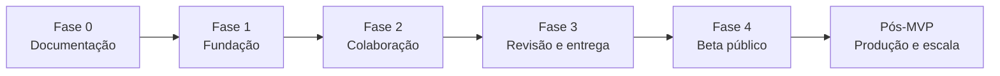

# Roadmap

**Status:** vivo; revisado a cada fase
**Última atualização:** 2026-10-23

---

## 1. Como ler este roadmap

O roadmap organiza o produto em fases com critérios de saída verificáveis. Ele não é uma promessa de data. As durações são estimativas relativas para uma equipe pequena de produto e engenharia, e devem ser recalibradas a cada fase com dados reais.

A regra de sequenciamento é simples: **não construir colaboração em cima de um layout que ainda muda, nem PDF em cima de uma paginação instável.** A fundação de formato e layout vem antes de tudo que depende dela.

## 2. Fase 0: documentação e decisões

**Objetivo:** reduzir incerteza antes de escrever código.

**Entregas:**

- visão, personas e jornadas;
- SRS com requisitos e critérios de aceite;
- normas de formatação, elementos e paginação;
- arquitetura, modelo de dados, API, colaboração e PDF;
- segurança, UX, testes, operações e este roadmap;
- ADRs das decisões estruturais;
- fontes e referências.

**Critério de saída:**

- documentação revisada e aprovada;
- nenhuma regra de formatação sem fonte ou marcação de decisão de produto;
- decisões abertas registradas com impacto e fase de resolução;
- riscos principais com mitigação.

**Status:** concluída em 2026-10-23, sujeita a revisão com roteiristas.

## 3. Fase 1: fundação

**Objetivo:** provar que o produto consegue escrever e exportar um roteiro com layout fiel, antes de adicionar colaboração.

**Escopo:**

- monorepo, CI, ambientes local e preview;
- autenticação com e-mail e senha, verificação e recuperação;
- projetos e membros com papéis;
- editor individual com schema ProseMirror;
- editor responsivo com modo mobile linear e prévia paginada;
- PWA instalável com shell offline;
- motor de layout com as 20 fixtures obrigatórias;
- página de título;
- prévia paginada;
- exportação de PDF assíncrona com Chromium fixado;
- validação de formato e painel de erros/avisos;
- observabilidade básica e auditoria;
- limites de 300 páginas e de tamanho de documento.

**Fora desta fase:** colaboração em tempo real, comentários, versões nomeadas, importação, A4 completo. Não há fase de faturamento: o produto é gratuito.

**Critério de saída:**

1. Um roteiro de 10 páginas com todos os elementos exporta em PDF.
2. O PDF e a prévia têm o mesmo número de páginas e as mesmas quebras.
3. A fonte está incorporada e o texto é selecionável.
4. A página de título não é numerada.
5. `(MORE)` e `(CONT'D)` funcionam.
6. Nenhum cabeçalho, personagem ou parêntese fica isolado no fim da página.
7. Um roteiro de 120 páginas exporta em p95 inferior a 15 s.
8. Um roteiro é criado, editado e exportado em viewport de 360 px no modo mobile.
9. Nenhum fluxo exige pagamento, assinatura ou cartão de crédito.
10. O fluxo principal passa em teste de teclado no desktop e de toque no celular.
11. Nenhum conteúdo de roteiro aparece em log.

**Duração estimada:** 12 a 16 semanas para uma equipe de 4 a 6 pessoas.

**Riscos:**

| Risco | Mitigação |
|---|---|
| Motor de layout consumir mais tempo que o previsto | Começar pelas fixtures e pelo hash; manter o editor simples até a paginação estabilizar |
| Divergência entre prévia e PDF | Uma única composição; teste de paridade no CI desde a primeira semana |
| Complexidade do schema | Modelo mínimo viável, com extensões documentadas |
| Chromium no worker | Container fixo e smoke de PDF desde o início |
| Modo mobile divergir do layout | Editor linear usa o mesmo schema; prévia e PDF validados por golden tests |

## 4. Fase 2: colaboração

**Objetivo:** duas pessoas editam o mesmo roteiro ao vivo, sem conflito e sem perda.

**Escopo:**

- serviço Hocuspocus com autenticação por token;
- Yjs com `y-prosemirror` e `y-indexeddb`;
- presença, cursores e seleção;
- sincronização entre instâncias via Redis;
- persistência debounced, log de atualizações e snapshots;
- reconexão e modo offline;
- normalização de estrutura concorrente;
- limites de conexão, mensagem e taxa;
- métricas e runbooks de colaboração.

**Fora desta fase:** comentários, versões nomeadas, comparação de versões.

**Critério de saída:**

1. Duas sessões editam o mesmo roteiro e convergem.
2. Um cliente offline por 10 minutos reconecta sem perder texto.
3. Duas instâncias de colaboração sincronizam via Redis.
4. Um `viewer` não consegue editar, mesmo com cliente modificado.
5. 50 conexões simultâneas no mesmo roteiro funcionam dentro da meta.
6. Uma queda de Redis não perde documento.
7. Edições concorrentes não produzem estrutura inválida renderizada.
8. Latência de propagação p95 inferior a 300 ms na mesma região.

**Duração estimada:** 6 a 9 semanas.

**Dependências:** fase 1 concluída; modelo de dados de snapshots e permissões estável; Redis disponível em staging.

**Riscos:**

| Risco | Mitigação |
|---|---|
| Convergência estrutural | Testes de propriedade e normalização no servidor |
| Memória por sala | Limite de documento, monitoramento, desconexão de inativos |
| Complexidade operacional | Serviço isolado, runbook e caos test desde o início |
| Undo colaborativo | Undo local no MVP; undo global fora de escopo |

## 5. Fase 3: revisão e entrega

**Objetivo:** fechar o ciclo de escrita, revisão, versionamento e entrega.

**Escopo:**

- comentários ancorados com threads, menções e resolução;
- comentários desanexados;
- versões automáticas e nomeadas;
- comparação de versões;
- restauração sem apagar histórico;
- opções de exportação: intervalo, marca d'água, listas de cenas e personagens;
- histórico de exportações;
- notificações no app e e-mail;
- link de leitura com expiração e revogação;
- trilha de auditoria visível para `owner`;
- exportação A4 com aviso.

**Critério de saída:**

1. Um comentário sobrevive a uma edição ao redor ou fica explicitamente desanexado.
2. Um usuário restaura uma versão anterior sem perder o histórico.
3. Um `owner` vê quem exportou, quando e qual versão.
4. Um link de leitura expira e pode ser revogado.
5. Um PDF com intervalo de páginas mantém a numeração original.
6. Listas de cenas e personagens não alteram a paginação do roteiro.
7. Notificações não vazam conteúdo de roteiro.

**Duração estimada:** 6 a 8 semanas.

**Dependências:** fase 2 concluída; modelo de comentários e versões; e-mail transacional.

**Riscos:**

| Risco | Mitigação |
|---|---|
| Ancoragem de comentário frágil | Posições relativas do Yjs e estado explícito de "desanexado" |
| Restauração confundir usuários | Criar nova versão, nunca sobrescrever; resumo claro antes de confirmar |
| Escopo de exportação crescer | Opções congeladas por fase; anexos fora da paginação |
| Notificação virar spam | Preferências, agrupamento e limite diário |

## 6. Fase 4: beta público

**Objetivo:** abrir para usuários reais com confiança operacional.

**Escopo:**

- hardening de segurança e acessibilidade;
- teste de carga com 10.000 usuários simultâneos por região;
- caos e recuperação de desastre;
- onboarding e central de ajuda;
- limites de uso, proteção contra abuso e medição de consumo;
- status page e suporte;
- revisão jurídica de termos e privacidade;
- lista de subprocessadores;
- programa de feedback e métricas de produto;
- correções de UX vindas de testes com roteiristas.

**Critério de saída:**

1. Todos os critérios de aceite do MVP da SRS são verdadeiros.
2. Nenhum S1 ou S2 aberto.
3. Disponibilidade de 99,9% medida em staging por 30 dias.
4. Restauração de backup testada.
5. Auditoria de acessibilidade concluída.
6. Revisão de segurança concluída.
7. Status page, suporte e on-call ativos.
8. Termos, privacidade e subprocessadores publicados.
9. Rollback ensaiado em produção.
10. Nenhum conteúdo de roteiro em log ou trace.

**Duração estimada:** 4 a 6 semanas.

**Riscos:**

| Risco | Mitigação |
|---|---|
| Custo de Chromium e storage | Cache, retenção, limite por conta, monitoramento de custo |
| Suporte a muitos usuários | Base de conhecimento, diagnóstico no produto, plantão |
| Abuso e fraude | Rate limit, limites de uso, verificação de e-mail |
| Feedback contraditório | Métricas e entrevistas, não apenas pedidos isolados |

## 7. Pós-MVP

Itens deliberadamente fora do MVP, em ordem de avaliação:

| Tema | Valor | Pré-condição |
|---|---|---|
| Números de cena e cores de revisão | Produção e shooting script | Modelo de dados preparado; demanda de produtoras |
| Importação FDX e Fountain | Migração de usuários | Parser validado e round-trip |
| Polimento avançado do editor mobile | Conforto em telas pequenas | Base mobile validada; gestos e seleção estendida |
| Aplicativo nativo | Distribuição | Demanda e custo de manutenção |
| Colaboração entre organizações | Governança | Modelo de permissão e auditoria |
| IA de apoio à escrita | Diferenciação | Privacidade, custo e opt-in |
| Análise de roteiro e cobertura | Produtores | Modelo de dados e revisão humana |
| Localização de interface | Mercado | en-US, es, fr |

Cada item exige um ADR ou uma atualização de SRS antes de entrar no roadmap ativo.

## 8. Dependências entre fases

| Fase | Depende de | Bloqueia |
|---|---|---|
| 1 | Documentação aprovada, Courier Prime fixada, Chromium fixado | 2, 3 |
| 2 | Layout estável, permissões, Redis, snapshots | 3 |
| 3 | Colaboração estável, modelo de comentários, e-mail | 4 |
| 4 | Tudo acima, operação e jurídico | Lançamento |

Se a fase 1 atrasar, a fase 2 não começa com layout instável. Se a fase 2 atrasar, a fase 3 pode adiantar comentários e versões, mas não a exportação colaborativa.

## 9. Decisões abertas

| Decisão | Fase limite | Impacto se não resolvida |
|---|---|---|
| Sustentabilidade de custos | Antes da fase 4 | Limites de uso, capacidade, escolha de provedor |
| Importação FDX/Fountain/PDF | Fase 3 | Escopo de migração e parser |
| Residência de dados | Antes da fase 4 | Infraestrutura, contratos, latência |
| Revisões de produção | Pós-MVP | Escopo de editor e PDF |
| IA | Pós-MVP | Produto, custo, privacidade |
| Licença do código | Antes do beta | Distribuição e contribuição |

## 10. Métricas de progresso

| Fase | Métrica de saída | Meta |
|---|---|---|
| 1 | PDF fiel em fixture de 10 páginas | 100% dos casos |
| 1 | Exportação de 120 páginas | p95 < 15 s |
| 1 | Edição e exportação em 360 px | 100% dos fluxos críticos |
| 2 | Convergência em teste de 10 réplicas | 100% |
| 2 | Latência de propagação | p95 < 300 ms |
| 3 | Comentários resolvidos | > 70% |
| 3 | Restaurações sem perda | 100% |
| 4 | Disponibilidade | 99,9% em 30 dias |
| 4 | Primeiro PDF em 7 dias | > 40% dos cadastros |

## 11. Processo de mudança

1. Nova ideia entra como item de avaliação, não como compromisso.
2. Se afeta arquitetura, formato ou segurança, exige ADR ou atualização de SRS.
3. Se afeta o MVP, exige remoção explícita de outro item, não acúmulo silencioso.
4. Se atrasa um critério de saída, a fase não avança.
5. O roadmap é revisado ao fim de cada fase, com dados de uso e de operação.

## 12. Referências

- [`../00-visao/visao-do-produto.md`](../00-visao/visao-do-produto.md)
- [`../01-requisitos/srs.md`](../01-requisitos/srs.md)
- [`../03-arquitetura/arquitetura-geral.md`](../03-arquitetura/arquitetura-geral.md)
- [`../05-qualidade/testes-e-aceite.md`](../05-qualidade/testes-e-aceite.md)
- [`../06-operacoes/deploy-e-observabilidade.md`](../06-operacoes/deploy-e-observabilidade.md)
